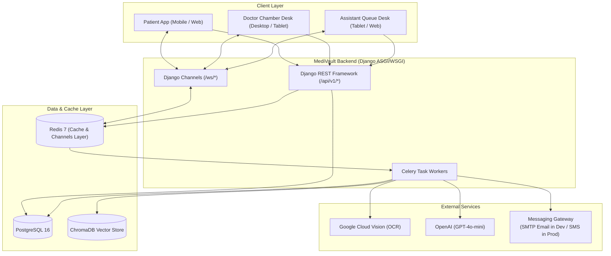

# MediVault 🩺🔒

> **An AI-Powered Personal Health Record and Patient–Doctor Communication Platform for Bangladesh**

[](https://www.python.org/)
[](https://www.djangoproject.com/)
[](https://reactjs.org/)
[](https://opensource.org/licenses/MIT)
[](http://localhost:8000/api/docs/)

---

## 📌 Motivation & Vision

The healthcare landscape in Bangladesh is characterized by fragmented paper records, scattered diagnostic test slips, and rapid 3-to-7 minute chamber consultations. Patients must remember years of medication regimens and lab numbers, while doctors must decipher faded prescriptions or practice without historical context.

**MediVault** is designed to solve this everyday gap:
1. **Digitize & Structure:** Instant mobile camera capture of paper prescriptions and lab slips with Google Cloud Vision OCR and GPT-4o-mini clinical entity extraction.
2. **Conversational Records Exploration:** Ask natural language questions in **Bangla or English** over personal health documents and vitals ("আমার শেষ ক্রিয়েটিনিন টেস্টের রেজাল্ট কত ছিল?").
3. **Instant In-Chamber Sharing:** Time-limited, encrypted QR-code handshake granting doctors an immediate 10-second summary (90-day glucose/BP trends, active medications, anomaly flags).
4. **Closed-Loop Digital Prescriptions:** Doctors write digital prescriptions with automated drug interaction checks, instantly auto-populating patient medication reminders.
5. **Real-Time Clinic Queue Sync:** Live synchronization between Clinic Assistants, Doctors, and Patients via WebSockets with dynamic token and wait-time updates.

---

## 🚀 Key Feature Matrix

```
MediVault Platform
│
├── 📱 Patient App
│   ├── 👨‍👩‍👧‍👦 Family Health Manager (Multiple profiles under 1 mobile account)
│   ├── 🩸 Daily Health Log (Fasting/Post-meal Glucose, BP, Weight, Symptoms)
│   ├── 🚨 Danger Alerts (Hypoglycemia <3.9, Hyperglycemia >16, BP Crisis >180/120)
│   ├── 📄 Document Vault (Camera OCR + AI Entity Extraction + Timeline)
│   ├── 💊 Medication Adherence (Auto-extracted from Rx, Reminders, Refill alerts)
│   ├── 📅 Smart Appointment Memory (Escalated follow-up reminders: 2.5 mo → 1 wk)
│   ├── 📋 Pre-Appointment 3-Q Intake (AI-synthesized brief for upcoming consult)
│   ├── 🤖 Ask AI Assistant (RAG over documents + Health Education in Bangla & English)
│   └── 📊 Monthly Health Report (Auto-generated 1st of each month with PDF export)
│
├── 🩺 Doctor App
│   ├── 🤝 QR Consultation Handshake (Scans patient QR for instant read-only history)
│   ├── ⚡ AI Pre-Consultation Brief (10-second overview of 90-day vitals & anomalies)
│   ├── 👥 Patient Registry (Searchable longitudinal encounter history)
│   ├── ⏳ Live Chamber Queue (Real-time synchronization with assistant desk)
│   ├── ✍️ Digital Prescription Writer (Typeahead drugs + Drug interaction checks)
│   └── 🧪 Lab Result Flow (Push notifications when ordered tests are uploaded)
│
├── 🏥 Clinic Assistant App
│   ├── 📋 Today's Chamber Roster (Pre-booked appointments & Walk-in registrations)
│   ├── 🎟️ Queue Management Desk (Sequential token generation + wait-time display)
│   ├── 💬 Multi-Channel Token Dispatch (Patient receives live serial updates via Email in dev, SMS in prod)
│   └── 📈 End-of-Day Summary (Patients seen, wait averages, no-show metrics)
│
└── 🌉 Shared Bridge Layer
    ├── ⏱️ 30-Minute Ephemeral Consultation Sessions
    ├── 🔄 Automated Digital Prescription → Patient Medication Reminder Loop
    └── ⚡ Low-Latency WebSocket Queue Synchronization
```

---

## 🛠️ Technology Stack

| Layer | Technology | Purpose |
|---|---|---|
| **Backend Framework** | Django 5.x + Django REST Framework | REST APIs, User Management, ORM, Admin Panel |
| **Real-Time WebSockets**| Django Channels (Daphne ASGI) + Redis | Live Chamber Queue & Notification Broadcasts |
| **Relational Database** | PostgreSQL 16 | Primary ACID store for users, vitals, prescriptions |
| **Vector Database** | ChromaDB | Embeddings & semantic vector retrieval for RAG |
| **Asynchronous Tasks** | Celery 5.x + Redis 7 Broker | Background OCR parsing, Monthly PDF generation |
| **OCR Vision Engine** | Google Cloud Vision API | Document text & handwriting detection |
| **Generative Clinical AI** | OpenAI API (`gpt-4o-mini`, `text-embedding-3-small`)| Entity extraction, RAG Q&A, Drug interaction checking |
| **Frontend Prototype** | React 18 + Vite + TypeScript + Tailwind CSS | Fast functional prototype across all 3 roles |
| **Production Mobile** | Flutter / React Native | Native Android & iOS cross-platform applications |
| **API Documentation** | drf-spectacular (OpenAPI 3.1 & Swagger) | Auto-generated interactive API schema |

---

## 🏗️ System Architecture



---

## ⚡ Quick Start (Docker Compose)

The easiest way to run the entire MediVault infrastructure is using Docker Compose.

### 1. Clone & Configure
```bash
git clone https://github.com/your-org/medivault.git
cd medivault

# Copy environment template
cp .env.example .env
```

### 2. Add API Credentials in `.env`
Open `.env` and configure:
```env
OPENAI_API_KEY=sk-proj-your-openai-api-key
GOOGLE_APPLICATION_CREDENTIALS=/app/gcp-credentials.json
```
*(Place your GCP Service Account JSON key in the project root as `gcp-credentials.json`)*

### 3. Spin Up All Containers
```bash
docker compose up --build -d
```

### 4. Verify Services
- **Django REST API & Admin:** [http://localhost:8000/api/v1/](http://localhost:8000/api/v1/)
- **Interactive Swagger Documentation:** [http://localhost:8000/api/docs/](http://localhost:8000/api/docs/)
- **React Frontend Prototype:** [http://localhost:3000/](http://localhost:3000/)
- **PostgreSQL Database:** `localhost:5432`
- **Redis Cache & Broker:** `localhost:6379`

---

## 📖 Complete Documentation Index

All detailed specifications are located in the [`docs/`](./docs/) directory:

1. [**PRD.md**](./docs/PRD.md) — Comprehensive Product Requirements, Personas, User Stories, and NFRs.
2. [**Design.md**](./docs/Design.md) — UI/UX Design System, Figma screen mapping, components, and color tokens.
3. [**Architecture.md**](./docs/Architecture.md) — Technical Architecture, modular monolith breakdown, and data pipelines.
4. [**Database.md**](./docs/Database.md) — Full PostgreSQL ERD, complete Django model code, and indexing strategy.
5. [**API.md**](./docs/API.md) — Complete REST & WebSocket specification with realistic medical JSON payloads.
6. [**Agents.md**](./docs/Agents.md) — AI Agents specification, prompt library, OCR pipelines, and token economics.
7. [**Implementation.md**](./docs/Implementation.md) — Step-by-step 14-week phase-by-phase development guide.
8. [**Setup.md**](./docs/Setup.md) — Comprehensive local machine, Docker, and IDE setup guide.
9. [**Feature_Development.md**](./docs/Feature_Development.md) — Detailed blueprint for implementing all 14 core features.
10. [**Authentication_Security.md**](./docs/Authentication_Security.md) — RBAC, JWT, QR token encryption, and HIPAA compliance.
11. [**Integration.md**](./docs/Integration.md) — Integration guide for Google Cloud Vision, OpenAI, and SMS Gateways.
12. [**Testing_QA.md**](./docs/Testing_QA.md) — Backend and frontend test suites, mock strategies, and QA checklists.
13. [**Debugging.md**](./docs/Debugging.md) — Debugging guides, logging configurations, and common error cheatsheet.

---

## 🔒 Security & Privacy Notice
MediVault is designed with strict healthcare security best practices. Ephemeral consultation tokens expire in 30 minutes, all file storage is restricted to authorized owners, and danger vitals automatically trigger dual-channel notifications. MediVault organizes, surfaces, and clarifies medical records; **it does not make automated diagnoses or replace licensed physicians**.

---

## 📄 License
This project is licensed under the MIT License — see the [LICENSE](LICENSE) file for details.
