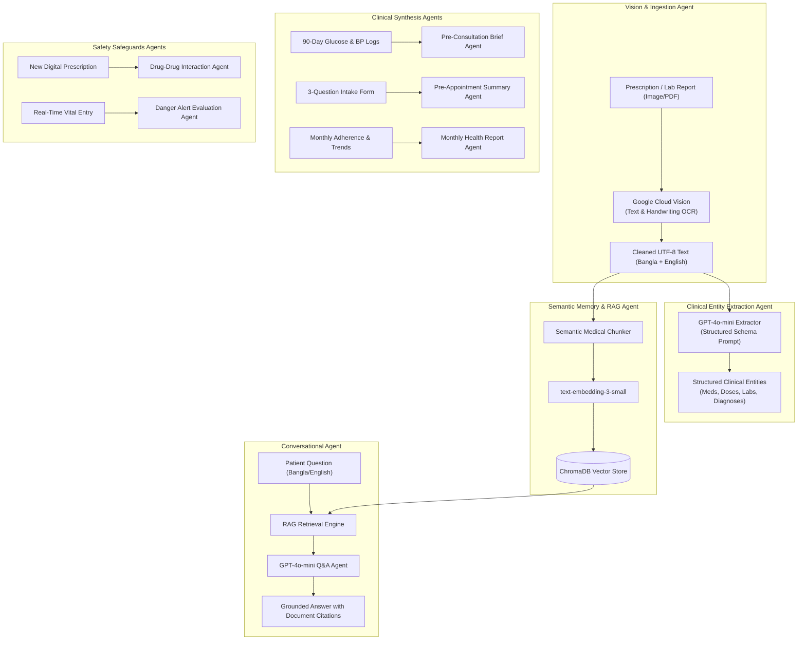

# MediVault — AI Agents & Clinical Intelligence Specification

> **Core Engine:** OpenAI API (`gpt-4o-mini`, `text-embedding-3-small`)  
> **Vision Engine:** Google Cloud Vision API (`DOCUMENT_TEXT_DETECTION`)  
> **Vector Database:** ChromaDB (`medivault_patient_documents`)  
> **Task Orchestrator:** Celery 5.x with Redis 7

---

## 1. AI Architecture Overview

MediVault's clinical intelligence is built as a set of specialized, decoupled agents. Each agent handles a single responsibility with strict prompt guardrails, validation schemas, and failure handling.



---

## 2. OCR Pipeline Agent

The OCR agent ingests scanned or photographed prescriptions, diagnostic test slips, and discharge certificates.

### 2.1 Implementation (`medivault/apps/ai_services/ocr_service.py`)

```python
import io
import os
from google.cloud import vision
from PIL import Image, ImageEnhance, ImageFilter

class OCRService:
    def __init__(self):
        self.client = vision.ImageAnnotatorClient()

    def preprocess_image(self, image_path: str) -> bytes:
        """Optimizes contrast, sharpness, and grayscale for medical text readability."""
        with Image.open(image_path) as img:
            # Convert to Grayscale
            img = img.convert('L')
            # Enhance contrast for faint thermal prints & blue ink ballpoint handwriting
            enhancer = ImageEnhance.Contrast(img)
            img = enhancer.enhance(1.8)
            # Apply slight unsharp mask to clarify blurred phone photos
            img = img.filter(ImageFilter.UnsharpMask(radius=2, percent=150, threshold=3))
            
            output = io.BytesIO()
            img.save(output, format='JPEG', quality=95)
            return output.getvalue()

    def extract_text_from_image(self, image_path: str) -> dict:
        """Sends preprocessed image to Google Cloud Vision Document Text Detection."""
        content = self.preprocess_image(image_path)
        image = vision.Image(content=content)

        # ImageContext hint for mixed English and Bengali
        image_context = vision.ImageContext(language_hints=['en', 'bn'])
        response = self.client.document_text_detection(image=image, image_context=image_context)

        if response.error.message:
            raise RuntimeError(f"GCP Vision Error: {response.error.message}")

        full_text = response.full_text_annotation.text if response.full_text_annotation else ""
        return {
            "raw_text": full_text.strip(),
            "confidence": response.full_text_annotation.pages[0].confidence if response.full_text_annotation.pages else 0.0
        }
```

---

## 3. Clinical Entity Extraction Agent

Extracts typed and handwritten prescriptions and lab reports into strongly-typed JSON schema using `gpt-4o-mini`.

### 3.1 Prompt Specification

```python
ENTITY_EXTRACTION_SYSTEM_PROMPT = """
You are MediVault Clinical Extraction AI, an expert medical informatics parser specializing in South Asian and Bangladeshi clinical documents.
Analyze the following raw OCR text extracted from a patient's medical document.

Rules:
1. Extract all medications, dosages, frequency (e.g. 1+0+1, once daily), relation to food (before/after), and duration.
2. Extract all clinical diagnoses, chief complaints, and past medical history.
3. Extract diagnostic lab test biomarkers with their numerical values, standard units, and reference ranges if present.
4. Extract doctor details (Name, BMDC number, Degrees) and Clinic/Hospital name.
5. If text is written in Bengali, translate clinical entities into standard English medical terminology while preserving the Bengali dosage instructions.
6. If information is absent or ambiguous, omit it or set it to null. Never hallucinate medications or values not present in the OCR text.

You MUST respond strictly with a valid JSON object matching this exact schema:
{
  "doctor": {
    "name": "string or null",
    "degrees": "string or null",
    "bmdc_number": "string or null"
  },
  "clinic_name": "string or null",
  "encounter_date": "YYYY-MM-DD or null",
  "diagnoses": ["string"],
  "medications": [
    {
      "brand_name": "string",
      "generic_name": "string or null",
      "strength": "string (e.g. 500mg)",
      "dosage_pattern": "string (e.g. 1+0+1)",
      "timing_relation": "string (e.g. After Food)",
      "duration": "string (e.g. 3 months)"
    }
  ],
  "lab_investigations": [
    {
      "test_name": "string",
      "result_value": "string",
      "unit": "string",
      "reference_range": "string or null",
      "is_abnormal": boolean
    }
  ],
  "follow_up_advice": "string or null"
}
"""
```

---

## 4. Semantic Memory & RAG Retrieval Agent

Enables conversational exploration of the patient's entire longitudinal record in natural Bangla or English.

### 4.1 Medical Document Chunking Strategy
- Medical records are grouped by encounter: `[Document Metadata] + [Diagnoses] + [Medications] + [Lab Results]`.
- Chunk Size: `512 tokens` with `64 token overlap`.
- Metadata tags on each vector: `patient_id`, `family_member_id`, `document_type`, `encounter_date`.

### 4.2 RAG Grounding Prompt

```python
RAG_SYSTEM_PROMPT = """
You are MediVault Health Assistant, a helpful clinical data navigator for a patient in Bangladesh.
You answer questions about the patient's own medical records using ONLY the provided retrieved clinical excerpts below.

Retrieved Context from Patient's Documents:
------------------------------------------
{context_chunks}
------------------------------------------

Guidelines:
1. Language: Answer in the same language the patient used (natural, empathetic Bengali or clear English).
2. Grounding: Rely strictly on the context chunks. If the patient asks about a test or medication not found in their records, state clearly: "আপনার আপলোড করা নথিপত্রে এই তথ্যটি পাওয়া যায়নি।"
3. Clarification: Clearly state which doctor, date, and document your answer comes from (e.g., "১৪ আগস্ট ২০২৬ তারিখের প্রফেসর নাসরিন আক্তারের প্রেসক্রিপশন অনুযায়ী...").
4. Strict Safety Guardrail: NEVER diagnose illnesses, recommend changing dosage, or declare a condition cured. Always add the reminder that doctor consultation is required.
"""
```

---

## 5. Pre-Appointment 3-Question Intake Agent

Before seeing the doctor, patients answer 3 simple guided questions in the app:
1. *What is your primary concern or problem today?* (আজকের প্রধান সমস্যা কী?)
2. *Any new or worsening symptoms since your last visit?* (নতুন কোনো উপসর্গ দেখা দিয়েছে কি?)
3. *Are you experiencing any side-effects or troubles with current medicines?* (বর্তমান ওষুধে কোনো সমস্যা হচ্ছে কি?)

### 5.1 Pre-Appointment Prompt

```python
PRE_APPOINTMENT_SUMMARY_PROMPT = """
You are an expert clinical summarizer. Synthesize the patient's pre-appointment intake responses together with their last 90 days of tracked vitals and active medications into a crisp, 1-paragraph clinical overview for the consulting doctor.

Patient Intake:
- Primary Concern: {q1_concern}
- Worsening Symptoms: {q2_symptoms}
- Medication Issues: {q3_side_effects}

90-Day Vitals Summary:
- Average Fasting Glucose: {avg_fasting} mmol/L (Normal: 4.0-6.0)
- Average Post-Prandial: {avg_post_meal} mmol/L (Normal: <7.8)
- Average BP: {avg_bp} mmHg
- Danger Spikes: {hypo_count} hypoglycemia events, {crisis_count} hypertensive spikes.

Active Medications: {active_medications}

Generate a 100-word clinical brief formatted in bullet points:
- Subjective Complaints
- Objective 90-Day Trend Highlights
- Medication Compliance & Tolerance
- Suggested Clinical Areas to Probe
"""
```

---

## 6. Drug-Drug Interaction Safeguard Agent

Verifies the doctor's newly entered digital prescription against the patient's existing active drug regimen before finalizing the order.

### 6.1 Interaction Checking Prompt

```python
DRUG_INTERACTION_PROMPT = """
You are a clinical pharmacology interaction verification engine.
Evaluate the following proposed combination of medications for potential adverse drug-drug interactions (DDIs).

Patient Active Medications:
{active_meds}

Newly Prescribed Medications:
{new_meds}

Known Patient Allergies:
{allergies}

Analyze pharmacokinetics, pharmacodynamics, QT prolongation risks, hypoglycemia risks, and duplicate therapies.

Return strictly a JSON object:
{
  "has_interactions": boolean,
  "highest_severity": "NONE" | "MINOR" | "MODERATE" | "SEVERE_CONTRAINDICATED",
  "alerts": [
    {
      "drugs_involved": ["Drug A", "Drug B"],
      "severity": "MINOR" | "MODERATE" | "SEVERE",
      "mechanism": "Short clinical explanation of interaction mechanism",
      "clinical_management": "Recommended action or monitoring instruction"
    }
  ]
}
"""
```

---

## 7. Monthly Health Report Agent

Runs automatically on the 1st day of every calendar month via Celery Beat.
- Aggregates the last 30 days of:
  - Glucose readings (Fasting vs Post-Meal averages)
  - Blood pressure (Systolic & Diastolic averages)
  - Medication adherence rate: `(Doses Taken / Total Scheduled Doses) * 100`
- Generates an encouraging, narrative paragraph in Bangla and English.
- Produces a downloadable PDF report with embedded charts and QR verification link.

---

## 8. Cost Projections & Token Optimization

MediVault utilizes `gpt-4o-mini` across all inference tasks, which provides high clinical parsing fidelity at minimal cost:

| Operation | Input Tokens | Output Tokens | Est. Cost per Call (USD) | Monthly Scale (1,000 Active Patients) |
|---|---|---|---|---|
| **Document OCR Parsing** | ~1,200 | ~350 | $0.00039 | $1.95 (5,000 uploads) |
| **Document Embedding (3-small)** | ~500 | 0 | $0.00001 | $0.05 |
| **Ask AI RAG Response** | ~1,500 | ~250 | $0.00037 | $3.70 (10,000 queries) |
| **Pre-Consultation Brief** | ~800 | ~200 | $0.00024 | $0.72 (3,000 consults) |
| **Drug Interaction Check** | ~600 | ~150 | $0.00018 | $0.54 (3,000 consults) |
| **Monthly Health Report** | ~1,000 | ~300 | $0.00033 | $0.33 (1,000 reports) |
| **Total Estimated AI Cost** | | | | **~$7.29 / month** |

> [!TIP]
> Using `gpt-4o-mini` keeps total AI operating expenditure below **$10 USD per month per 1,000 active chronic patients**, making MediVault commercially viable within Bangladesh's healthcare pricing realities.

