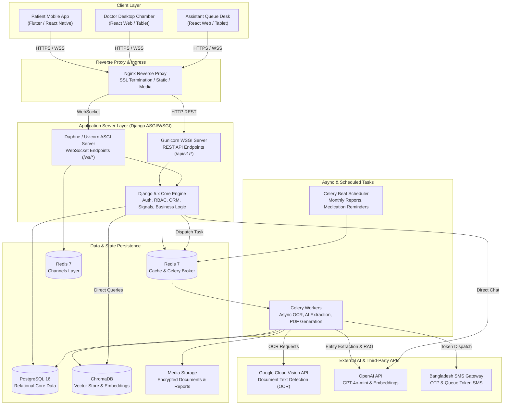
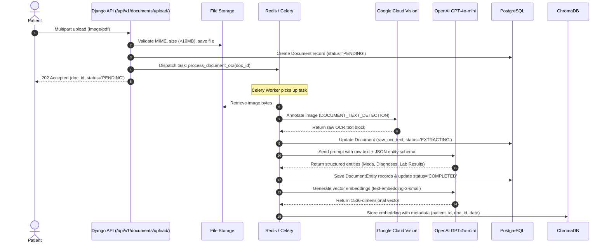
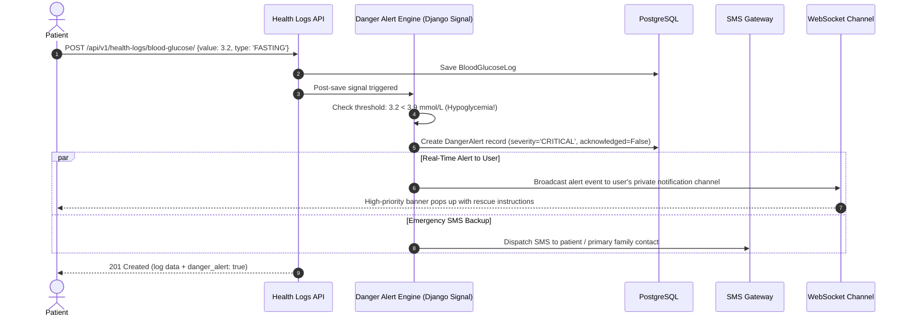
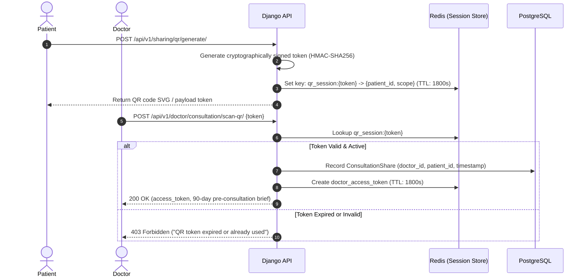
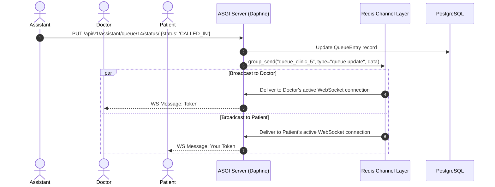

# MediVault — System Architecture & Technical Specifications

> **Target Version:** 1.0.0  
> **Backend Framework:** Django 5.x with Django REST Framework (DRF) & Django Channels (ASGI)  
> **Frontend Stack:** React 18+ (Prototype), Flutter / React Native (Final Mobile)  
> **AI & Vision:** OpenAI API (GPT-4o-mini, text-embedding-3-small), Google Cloud Vision API  
> **Persistence & Caching:** PostgreSQL 16, ChromaDB (Vector Store), Redis 7 (Broker & Channels Layer)

---

## 1. High-Level Architecture Overview

MediVault is designed around a modular monolithic architecture with asynchronous event-driven pipelines for compute-heavy AI/OCR workloads and real-time bidirectional communication for clinical chamber operations.



---

## 2. Django Project Structure

MediVault uses a clean, domain-driven modular application structure located under `medivault/apps/`:

```
medivault/
├── manage.py
├── config/                         # Project settings & ASGI/WSGI entrypoints
│   ├── __init__.py
│   ├── asgi.py                     # ASGI config with ProtocolTypeRouter
│   ├── wsgi.py                     # Standard WSGI config
│   ├── urls.py                     # Root URL routing & Swagger docs
│   ├── celery.py                   # Celery application initialization
│   └── settings/
│       ├── __init__.py
│       ├── base.py                 # Core settings, installed apps, middleware
│       ├── development.py          # Local settings, debug toolbar
│       └── production.py           # Strict security, SSL, S3, connection pools
├── apps/
│   ├── accounts/                   # Custom User, phone verification, RBAC
│   ├── patients/                   # Patient profile, family member manager
│   ├── doctors/                    # Doctor profiles, chamber schedules
│   ├── clinics/                    # Clinic chamber registry, assistant profiles
│   ├── documents/                  # Document uploads, OCR pipeline, timeline
│   ├── health_logs/                # Blood glucose, BP, vitals, danger checks
│   ├── medications/                # Drug schedules, dose adherence, reminders
│   ├── prescriptions/              # Digital prescription writer, interaction checks
│   ├── appointments/               # Pre-booked visits, chamber queue, token dispatch
│   ├── sharing/                    # QR-code consultation handshake & audit logs
│   ├── ai_services/                # OpenAI client, RAG pipeline, ChromaDB sync
│   ├── reports/                    # Monthly health reports, PDF generators
│   ├── notifications/              # In-app alerts, SMS notification handlers
│   └── common/                     # Base models, custom permissions, utilities
├── media/                          # Uploaded medical scans and generated PDFs
├── static/                         # Static CSS/JS for Django admin and Swagger
└── templates/                      # Email and PDF report HTML templates
```

---

## 3. Data Flow Pipelines

### 3.1 Document Upload, OCR & Entity Extraction Pipeline



---

### 3.2 Daily Health Log Entry & Danger Alert Evaluation



---

### 3.3 QR-Based Consultation Handshake & Session Expiration



---

### 3.4 Real-Time Queue Synchronization (WebSocket)



---

## 4. External Integrations Architecture

| External Service | Integration Purpose | Library / SDK | Failure & Fallback Strategy |
|---|---|---|---|
| **Google Cloud Vision** | Full-page OCR, handwriting detection | `google-cloud-vision` | Exponential backoff (3 retries). If OCR fails, flag document as `OCR_FAILED` and notify user for manual entry or image re-upload. |
| **OpenAI API** | Entity extraction, RAG embeddings, health summaries, drug interaction analysis | `openai>=1.30.0` | Circuit breaker pattern. Rate-limit (429) backoff. Fallback cached responses for standard drug queries. |
| **ChromaDB** | Vector similarity search for patient medical history queries | `chromadb-client` | Run ChromaDB container alongside PostgreSQL with persistent Docker volume storage. |
| **Bangladesh SMS Gateway** | OTP, Queue Token updates, Danger vitals alerts | Custom HTTP REST adapter (`httpx`) | Fallback to in-app push notifications if external SMS gateway responds with non-200. |

---

## 5. Security & Isolation Architecture

1. **Defense-in-Depth RBAC:**
   - Permissions are enforced strictly in Django ViewSet `permission_classes`.
   - Patients can only query objects where `patient = request.user.patient_profile`.
   - Doctors can only query patient data when an active, non-expired `ConsultationShare` exists in Redis or PostgreSQL.
2. **Data Minimization in QR Handshake:**
   - Scanned QR tokens only provide access to metadata, active medications, recent vitals, and last 3 consultation reports unless the patient explicitly checks "Full Medical Lifetime".
3. **Audit Trail Logging:**
   - Every file download, QR scan, and clinical record access is written to `ShareAuditLog` with IP address, user-agent, timestamp, and accessed document IDs.

