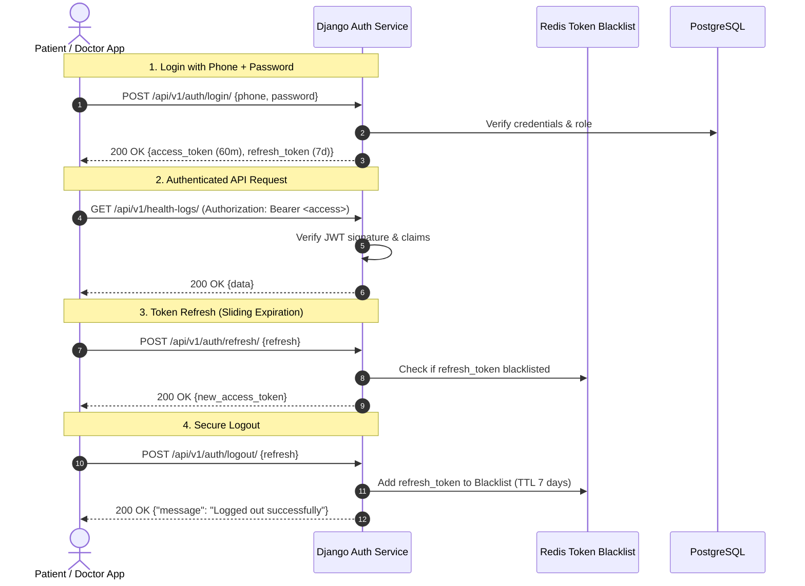
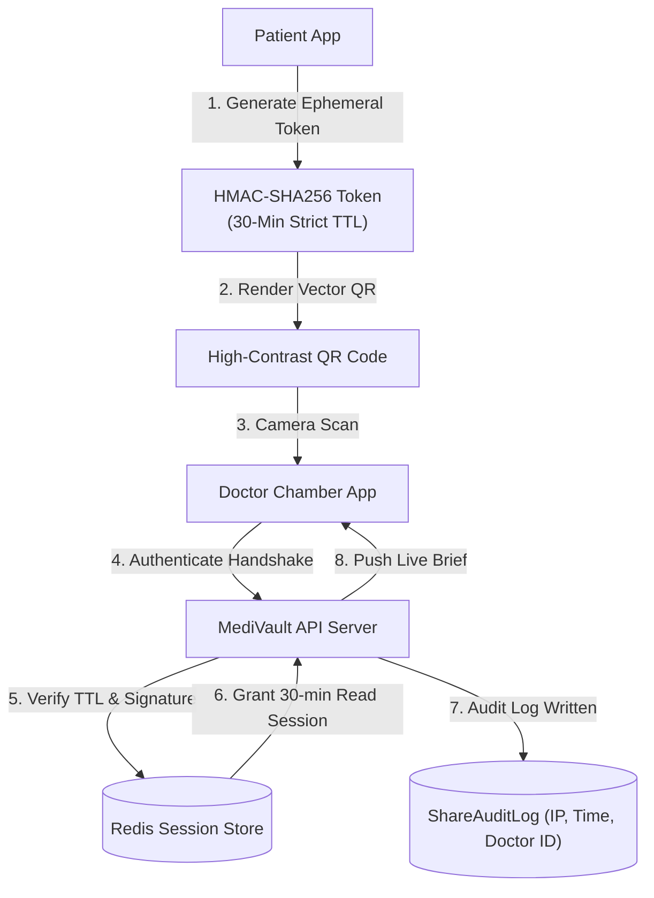

# MediVault — Authentication & Security Architecture

> **Security Standard:** Healthcare Data Protection & Role-Based Access Control (RBAC)  
> **Auth Implementation:** JWT (Stateless Bearer Tokens) via `djangorestframework-simplejwt`  
> **Encryption:** TLS 1.3 In-Transit, AES-256 At-Rest, HMAC-SHA256 Ephemeral QR Signatures

---

## 1. Authentication Architecture & Token Lifecycle

MediVault enforces strict stateless JSON Web Token (JWT) authentication across all REST and WebSocket connections.



### 1.1 JWT Configuration (`config/settings/base.py`)
```python
from datetime import timedelta

SIMPLE_JWT = {
    'ACCESS_TOKEN_LIFETIME': timedelta(minutes=60),
    'REFRESH_TOKEN_LIFETIME': timedelta(days=7),
    'ROTATE_REFRESH_TOKENS': True,
    'BLACKLIST_AFTER_ROTATION': True,
    'UPDATE_LAST_LOGIN': True,
    'ALGORITHM': 'HS256',
    'SIGNING_KEY': env('SECRET_KEY'),
    'AUTH_HEADER_TYPES': ('Bearer',),
    'AUTH_TOKEN_CLASSES': ('rest_framework_simplejwt.tokens.AccessToken',),
    'TOKEN_TYPE_CLAIM': 'token_type',
    'JTI_CLAIM': 'jti',
}
```

### 1.2 Dual-Mode OTP Verification Architecture (SMTP Email vs. SMS)

To keep development and prototype testing cost-effective before commercial launch, MediVault implements an architectural abstraction layer for messaging and OTP delivery:

```mermaid
graph TD
    User([User Registration / Login]) -->|Request 6-Digit OTP| API[Django Auth Service]
    API -->|1. Generate Cryptographic OTP| Redis[("Redis Cache<br/>(5-Min Salt-Hashed TTL)")]
    API -->|2. Check Config| Dispatcher{MESSAGING_BACKEND}
    Dispatcher -->|'email' (Prototype / Dev)| SMTP[SMTP Email Service<br/>Gmail / SendGrid / Custom]
    Dispatcher -->|'sms' (Live Production)| SMSGateway[Bangladesh SMS Gateway<br/>GP / Robi / Banglalink API]
    SMTP -->|Deliver Verification Code| UserMail([User Email Inbox])
    SMSGateway -->|Deliver SMS Code| UserPhone([User Mobile Phone])
```

#### Dual-Mode Invariants:
1. **Zero-Cost Prototyping:** While in prototype and staging environments, `MESSAGING_BACKEND=email` delivers all registration OTPs, password reset links, serial token call-ins, and emergency danger alerts directly to user email addresses via standard SMTP.
2. **Instant Production Flip:** Switching to production SMS requires solely updating `.env` (`MESSAGING_BACKEND=sms` + `SMS_API_KEY`), requiring zero modification to serializers, views, or mobile/web client contracts.
3. **Anti-Brute Force Protections:**
   - Maximum 3 incorrect OTP submission attempts per 5-minute window before the token is invalidated.
   - Throttled endpoint limits: max 5 requests per minute per IP address.
   - OTP codes are stored in Redis as salted SHA-256 hashes, never cleartext.

---

## 2. Role-Based Access Control (RBAC) Permissions

MediVault defines four discrete system roles:
1. `PATIENT`: Can manage their own health logs, documents, family members, medications, and generate sharing QR codes.
2. `DOCTOR`: Can view shared patient records during active handshakes, issue digital prescriptions, view assigned queue, and generate clinical reports.
3. `ASSISTANT`: Can manage chamber queue tokens, register walk-in patients, and dispatch serial notifications (Email in dev, SMS in production) for their specific clinic.
4. `ADMIN`: System configuration and analytics.

### 2.1 Custom Permission Classes (`apps/common/permissions.py`)

```python
from rest_framework import permissions
from django.utils import timezone
from apps.sharing.models import ConsultationShare

class IsPatient(permissions.BasePermission):
    """Allows access strictly to authenticated patient accounts."""
    message = "Access restricted to registered patient accounts."

    def has_permission(self, request, view):
        return bool(request.user and request.user.is_authenticated and request.user.role == 'PATIENT')


class IsDoctor(permissions.BasePermission):
    """Allows access strictly to verified doctor accounts."""
    message = "Access restricted to verified medical doctors."

    def has_permission(self, request, view):
        return bool(request.user and request.user.is_authenticated and request.user.role == 'DOCTOR')


class IsClinicAssistant(permissions.BasePermission):
    """Allows access strictly to clinic chamber assistants."""
    message = "Access restricted to authorized clinic assistants."

    def has_permission(self, request, view):
        return bool(request.user and request.user.is_authenticated and request.user.role == 'ASSISTANT')


class IsOwnerOrSharedDoctor(permissions.BasePermission):
    """
    Object-level permission allowing access to:
    1. The patient who owns the medical record.
    2. A doctor who has an active, non-expired ConsultationShare session for this patient.
    """
    message = "You do not have active clinical authorization to view this medical record."

    def has_object_permission(self, request, view, obj):
        # Patient self-access
        patient_profile = getattr(obj, 'patient', None)
        if not patient_profile and hasattr(obj, 'user'):
            patient_profile = getattr(obj.user, 'patient_profile', None)

        if request.user.role == 'PATIENT':
            return patient_profile and patient_profile.user == request.user

        # Doctor access via active consultation handshake
        if request.user.role == 'DOCTOR':
            doctor_profile = getattr(request.user, 'doctor_profile', None)
            if not doctor_profile:
                return False

            has_active_share = ConsultationShare.objects.filter(
                patient=patient_profile,
                doctor=doctor_profile,
                is_active=True,
                expires_at__gt=timezone.now()
            ).exists()
            return has_active_share

        return False
```

---

## 3. QR Consultation Handshake Security Protocol

The QR Consultation Handshake solves the in-chamber friction of patient-to-doctor data transfer without requiring manual email typing or permanent data exposure.



### 3.1 Security Invariants of QR Sharing
1. **Strict Ephemerality:** Tokens automatically self-expire after **1,800 seconds (30 minutes)** in Redis and PostgreSQL.
2. **One-Time Handshake Initialization:** Once scanned and claimed by a doctor, the handshake binds strictly to that doctor's authenticated session.
3. **Read-Only Scope:** The doctor session cannot modify, delete, or alter any historical records or uploaded documents.
4. **Immediate Patient Revocability:** Patients can tap `[Revoke Doctor Access]` on their phone at any time during the visit, immediately purging the doctor's access key from Redis.
5. **Immutable Audit Trail:** Every consultation scan creates an unalterable `ShareAuditLog` recording the doctor's BM&DC license number, chamber IP address, timestamp, and duration of access.

---

## 4. Data Protection & Encryption Architecture

### 4.1 Encryption In-Transit
- All incoming HTTP traffic is permanently redirected to HTTPS via Nginx using TLS 1.3 with high-security cipher suites:
  `TLS_AES_128_GCM_SHA256:TLS_AES_256_GCM_SHA384:TLS_CHACHA20_POLY1305_SHA256`.
- HSTS (HTTP Strict Transport Security) header enabled with `max-age=31536000; includeSubDomains; preload`.

### 4.2 Encryption At-Rest
- PostgreSQL storage volumes use transparent disk-level LUKS encryption or AWS KMS AES-256 managed encryption.
- Uploaded medical scans (JPEGs, PNGs, PDFs) are stored in private media directories with access mediated strictly through authenticated Django streaming responses (`X-Accel-Redirect` / signed presigned URLs), completely blocking unauthenticated direct file URL access.

### 4.3 Sensitive Field Minimization
- Passwords use Django's `PBKDF2PasswordHasher` with a SHA256 hash and 720,000 iterations.
- Temporary OTP verification codes are stored with a 5-minute TTL and salt-hashed in Redis, preventing cleartext recovery from cache dumps.

---

## 5. API Hardening & Abuse Defenses

### 5.1 Rate Limiting / Throttling (`config/settings/base.py`)
To safeguard against brute-force attacks and abuse of expensive OpenAI / GCP Vision endpoints:

```python
REST_FRAMEWORK['DEFAULT_THROTTLE_CLASSES'] = [
    'rest_framework.throttling.AnonRateThrottle',
    'rest_framework.throttling.UserRateThrottle',
]

REST_FRAMEWORK['DEFAULT_THROTTLE_RATES'] = {
    'anon': '30/minute',
    'user': '120/minute',
    'auth_login': '5/minute',       # Prevent credential stuffing
    'ocr_upload': '10/hour',        # Limit expensive OCR calls per patient
    'ai_query': '30/hour',          # Prevent RAG model exhaustion
}
```

### 5.2 File Upload Validation Guardrails (`apps/documents/validators.py`)
```python
import magic
from django.core.exceptions import ValidationError

ALLOWED_MIME_TYPES = ['image/jpeg', 'image/png', 'image/webp', 'application/pdf']
MAX_FILE_SIZE_BYTES = 10 * 1024 * 1024  # 10 MB

def validate_medical_document_file(uploaded_file):
    if uploaded_file.size > MAX_FILE_SIZE_BYTES:
        raise ValidationError("File size exceeds maximum allowable limit of 10 MB.")

    # Read the first 2048 bytes for true magic byte inspection
    initial_bytes = uploaded_file.read(2048)
    uploaded_file.seek(0)
    mime_type = magic.from_buffer(initial_bytes, mime=True)

    if mime_type not in ALLOWED_MIME_TYPES:
        raise ValidationError(f"Unsupported file format: {mime_type}. Please upload a JPEG, PNG, WebP, or PDF.")
```

---

## 6. Production Security Checklist

| Checkpoint | Target Standard | Implementation Status |
|---|---|---|
| `DEBUG` Mode | `False` in production | Configured via `DJANGO_DEBUG=False` in `.env` |
| `ALLOWED_HOSTS` | Explicit production domain whitelist | Enforced in `config/settings/production.py` |
| Secure Cookies | `SESSION_COOKIE_SECURE = True`, `CSRF_COOKIE_SECURE = True` | Enforced |
| Cookie HttpOnly | `SESSION_COOKIE_HTTPONLY = True`, `CSRF_COOKIE_HTTPONLY = True` | Enforced |
| XSS Protection | `SECURE_BROWSER_XSS_FILTER = True`, `SECURE_CONTENT_TYPE_NOSNIFF = True` | Enforced |
| Frame Denial | `X_FRAME_OPTIONS = 'DENY'` | Blocks iframe clickjacking |
| CORS Whitelist | Strictly bounded to frontend domain | Enforced via `django-cors-headers` |
| File Traversal | Sanitized UUID filenames for all stored media | Enforced in document model upload path |

