# MediVault — Database Design & Data Models Specification

> **Primary Database:** PostgreSQL 16  
> **ORM Layer:** Django 5.x ORM  
> **Vector Store:** ChromaDB (Collections: `medivault_patient_documents`)  
> **Cache & Session Store:** Redis 7

---

## 1. Entity-Relationship Diagram (ERD)

```mermaid
erDiagram
    User ||--o| PatientProfile : "is"
    User ||--o| DoctorProfile : "is"
    User ||--o| ClinicAssistantProfile : "is"
    
    PatientProfile ||--o{ FamilyMember : "manages"
    PatientProfile ||--o{ MedicalDocument : "owns"
    PatientProfile ||--o{ BloodGlucoseLog : "records"
    PatientProfile ||--o{ BloodPressureLog : "records"
    PatientProfile ||--o{ WeightLog : "records"
    PatientProfile ||--o{ HeartRateLog : "records"
    PatientProfile ||--o{ DangerAlert : "receives"
    PatientProfile ||--o{ Medication : "takes"
    PatientProfile ||--o{ Appointment : "books"
    PatientProfile ||--o{ ConsultationShare : "authorizes"
    PatientProfile ||--o{ MonthlyHealthReport : "receives"

    MedicalDocument ||--o{ DocumentEntity : "contains"
    
    DoctorProfile ||--o{ DoctorSpecialization : "has"
    DoctorProfile ||--o{ ClinicDoctorAssociation : "practices_at"
    DoctorProfile ||--o{ Prescription : "issues"
    DoctorProfile ||--o{ ConsultationShare : "views"

    Clinic ||--o{ ClinicAssistantProfile : "employs"
    Clinic ||--o{ ClinicDoctorAssociation : "hosts"
    Clinic ||--o{ QueueEntry : "manages"
    Clinic ||--o{ Appointment : "schedules"

    Prescription ||--o{ PrescriptionMedication : "contains"
    Prescription ||--o{ OrderedInvestigation : "orders"

    Appointment ||--o| QueueEntry : "generates"
    Appointment ||--o| PreAppointmentSummary : "has"

    Medication ||--o{ MedicationReminder : "schedules"
    Medication ||--o{ MedicationAdherence : "tracks"
```



---

## 2. Complete Django Model Implementations

Below are the production-grade Django model definitions organized by application domain.

### 2.1 Core & Accounts (`medivault.apps.accounts.models`)

```python
import uuid
from django.db import models
from django.contrib.auth.models import AbstractUser, BaseUserManager
from django.utils.translation import gettext_lazy as _

class UserManager(BaseUserManager):
    def create_user(self, phone_number, password=None, **extra_fields):
        if not phone_number:
            raise ValueError(_("Phone number must be provided"))
        user = self.model(phone_number=phone_number, **extra_fields)
        user.set_password(password)
        user.save(using=self._db)
        return user

    def create_superuser(self, phone_number, password=None, **extra_fields):
        extra_fields.setdefault('is_staff', True)
        extra_fields.setdefault('is_superuser', True)
        extra_fields.setdefault('role', User.Role.ADMIN)
        return self.create_user(phone_number, password, **extra_fields)


class User(AbstractUser):
    class Role(models.TextChoices):
        PATIENT = 'PATIENT', _('Patient')
        DOCTOR = 'DOCTOR', _('Doctor')
        ASSISTANT = 'ASSISTANT', _('Clinic Assistant')
        ADMIN = 'ADMIN', _('System Administrator')

    username = None  # Using phone number as primary unique login handle
    id = models.UUIDField(primary_key=True, default=uuid.uuid4, editable=False)
    phone_number = models.CharField(_("Phone Number"), max_length=15, unique=True, db_index=True)
    email = models.EmailField(_("Email Address"), blank=True, null=True)
    full_name = models.CharField(_("Full Name"), max_length=255)
    role = models.CharField(_("System Role"), max_length=20, choices=Role.choices, default=Role.PATIENT)
    is_phone_verified = models.BooleanField(default=False)
    preferred_language = models.CharField(max_length=5, default='bn', choices=[('bn', 'Bangla'), ('en', 'English')])
    created_at = models.DateTimeField(auto_now_add=True)
    updated_at = models.DateTimeField(auto_now=True)

    USERNAME_FIELD = 'phone_number'
    REQUIRED_FIELDS = ['full_name']

    objects = UserManager()

    class Meta:
        verbose_name = _("User")
        verbose_name_plural = _("Users")
        indexes = [
            models.Index(fields=['phone_number', 'role']),
        ]

    def __str__(self):
        return f"{self.full_name} ({self.phone_number}) - {self.role}"
```

---

### 2.2 Patient Domain (`medivault.apps.patients.models`)

```python
class PatientProfile(models.Model):
    class BloodGroup(models.TextChoices):
        A_POS = 'A+', 'A+'
        A_NEG = 'A-', 'A-'
        B_POS = 'B+', 'B+'
        B_NEG = 'B-', 'B-'
        AB_POS = 'AB+', 'AB+'
        AB_NEG = 'AB-', 'AB-'
        O_POS = 'O+', 'O+'
        O_NEG = 'O-', 'O-'
        UNKNOWN = 'UNKNOWN', 'Unknown'

    class Gender(models.TextChoices):
        MALE = 'MALE', _('Male')
        FEMALE = 'FEMALE', _('Female')
        OTHER = 'OTHER', _('Other')

    id = models.UUIDField(primary_key=True, default=uuid.uuid4, editable=False)
    user = models.OneToOneField('accounts.User', on_delete=models.CASCADE, related_name='patient_profile')
    date_of_birth = models.DateField(blank=True, null=True)
    gender = models.CharField(max_length=10, choices=Gender.choices, default=Gender.MALE)
    blood_group = models.CharField(max_length=10, choices=BloodGroup.choices, default=BloodGroup.UNKNOWN)
    height_cm = models.DecimalField(max_digits=5, decimal_places=2, blank=True, null=True)
    emergency_contact_phone = models.CharField(max_length=15, blank=True, null=True)
    known_allergies = models.TextField(blank=True, help_text=_("Known food and drug allergies"))
    created_at = models.DateTimeField(auto_now_add=True)
    updated_at = models.DateTimeField(auto_now=True)

    def __str__(self):
        return f"Patient: {self.user.full_name}"


class FamilyMember(models.Model):
    class Relationship(models.TextChoices):
        PARENT = 'PARENT', _('Parent')
        SPOUSE = 'SPOUSE', _('Spouse')
        CHILD = 'CHILD', _('Child')
        SIBLING = 'SIBLING', _('Sibling')
        OTHER = 'OTHER', _('Other')

    id = models.UUIDField(primary_key=True, default=uuid.uuid4, editable=False)
    primary_account = models.ForeignKey(PatientProfile, on_delete=models.CASCADE, related_name='family_members')
    full_name = models.CharField(max_length=255)
    relationship = models.CharField(max_length=20, choices=Relationship.choices)
    date_of_birth = models.DateField(blank=True, null=True)
    gender = models.CharField(max_length=10, choices=PatientProfile.Gender.choices)
    blood_group = models.CharField(max_length=10, choices=PatientProfile.BloodGroup.choices, default=PatientProfile.BloodGroup.UNKNOWN)
    known_allergies = models.TextField(blank=True)
    created_at = models.DateTimeField(auto_now_add=True)

    def __str__(self):
        return f"{self.full_name} ({self.relationship} of {self.primary_account.user.full_name})"
```

---

### 2.3 Doctor & Clinic Domain (`medivault.apps.doctors.models` & `clinics.models`)

```python
class DoctorProfile(models.Model):
    id = models.UUIDField(primary_key=True, default=uuid.uuid4, editable=False)
    user = models.OneToOneField('accounts.User', on_delete=models.CASCADE, related_name='doctor_profile')
    bmdc_registration_number = models.CharField(max_length=50, unique=True, help_text="BM&DC Medical License Number")
    degrees_qualifications = models.CharField(max_length=255, help_text="e.g. MBBS, FCPS, MD (Internal Medicine)")
    primary_specialty = models.CharField(max_length=100)
    consultation_fee = models.DecimalField(max_digits=8, decimal_places=2, default=0.00)
    bio = models.TextField(blank=True)
    is_verified_practitioner = models.BooleanField(default=False)
    created_at = models.DateTimeField(auto_now_add=True)

    def __str__(self):
        return f"Dr. {self.user.full_name} ({self.primary_specialty})"


class Clinic(models.Model):
    id = models.UUIDField(primary_key=True, default=uuid.uuid4, editable=False)
    name = models.CharField(max_length=255)
    branch = models.CharField(max_length=100, blank=True)
    address = models.TextField()
    contact_phone = models.CharField(max_length=15)
    is_active = models.BooleanField(default=True)
    created_at = models.DateTimeField(auto_now_add=True)

    def __str__(self):
        return f"{self.name} - {self.branch}"


class ClinicAssistantProfile(models.Model):
    id = models.UUIDField(primary_key=True, default=uuid.uuid4, editable=False)
    user = models.OneToOneField('accounts.User', on_delete=models.CASCADE, related_name='assistant_profile')
    clinic = models.ForeignKey(Clinic, on_delete=models.CASCADE, related_name='assistants')
    desk_serial = models.CharField(max_length=50, blank=True)
    is_active = models.BooleanField(default=True)

    def __str__(self):
        return f"Assistant {self.user.full_name} ({self.clinic.name})"


class ClinicDoctorAssociation(models.Model):
    clinic = models.ForeignKey(Clinic, on_delete=models.CASCADE, related_name='doctor_associations')
    doctor = models.ForeignKey(DoctorProfile, on_delete=models.CASCADE, related_name='clinic_associations')
    chamber_number = models.CharField(max_length=50)
    session_days = models.CharField(max_length=100, help_text="e.g. Sat, Mon, Wed")
    session_start_time = models.TimeField()
    session_end_time = models.TimeField()

    class Meta:
        unique_together = ('clinic', 'doctor')
```

---

### 2.4 Document Management & OCR (`medivault.apps.documents.models`)

```python
class MedicalDocument(models.Model):
    class DocType(models.TextChoices):
        PRESCRIPTION = 'PRESCRIPTION', _('Prescription')
        LAB_REPORT = 'LAB_REPORT', _('Diagnostic Lab Report')
        RADIOLOGY = 'RADIOLOGY', _('Radiology / Imaging')
        DISCHARGE = 'DISCHARGE', _('Discharge Certificate')
        OTHER = 'OTHER', _('Other Health Document')

    class ProcessingStatus(models.TextChoices):
        PENDING = 'PENDING', _('Pending')
        PROCESSING_OCR = 'PROCESSING_OCR', _('Processing OCR')
        EXTRACTING_AI = 'EXTRACTING_AI', _('Extracting Clinical Data')
        COMPLETED = 'COMPLETED', _('Completed')
        FAILED = 'FAILED', _('Processing Failed')

    id = models.UUIDField(primary_key=True, default=uuid.uuid4, editable=False)
    patient = models.ForeignKey('patients.PatientProfile', on_delete=models.CASCADE, related_name='documents')
    family_member = models.ForeignKey('patients.FamilyMember', on_delete=models.SET_NULL, null=True, blank=True, related_name='documents')
    title = models.CharField(max_length=255, blank=True)
    document_type = models.CharField(max_length=30, choices=DocType.choices, default=DocType.PRESCRIPTION)
    file = models.FileField(upload_to='patient_documents/%Y/%m/')
    document_date = models.DateField(help_text="Original encounter date stated on document")
    issuing_doctor_name = models.CharField(max_length=255, blank=True)
    issuing_clinic_name = models.CharField(max_length=255, blank=True)
    
    # OCR & AI Outputs
    raw_ocr_text = models.TextField(blank=True)
    processing_status = models.CharField(max_length=20, choices=ProcessingStatus.choices, default=ProcessingStatus.PENDING)
    error_message = models.TextField(blank=True)
    chroma_vector_id = models.CharField(max_length=100, blank=True, db_index=True)
    created_at = models.DateTimeField(auto_now_add=True, db_index=True)

    class Meta:
        ordering = ['-document_date', '-created_at']
        indexes = [
            models.Index(fields=['patient', 'document_type', 'document_date']),
        ]

    def __str__(self):
        return f"{self.document_type} - {self.patient.user.full_name} ({self.document_date})"


class DocumentEntity(models.Model):
    class EntityType(models.TextChoices):
        MEDICATION = 'MEDICATION', _('Medication')
        DIAGNOSIS = 'DIAGNOSIS', _('Diagnosis / Clinical Condition')
        LAB_TEST = 'LAB_TEST', _('Biomarker / Lab Result')
        ALLERGY = 'ALLERGY', _('Reported Allergy')

    id = models.UUIDField(primary_key=True, default=uuid.uuid4, editable=False)
    document = models.ForeignKey(MedicalDocument, on_delete=models.CASCADE, related_name='extracted_entities')
    entity_type = models.CharField(max_length=20, choices=EntityType.choices)
    entity_name = models.CharField(max_length=255)
    entity_value = models.CharField(max_length=255, blank=True, help_text="e.g. 7.2 mmol/L or 500mg")
    unit = models.CharField(max_length=50, blank=True)
    reference_range = models.CharField(max_length=100, blank=True)
    is_abnormal = models.BooleanField(default=False)
    raw_snippet = models.TextField(blank=True)
```

---

### 2.5 Health Logs & Danger Alerts (`medivault.apps.health_logs.models`)

```python
class BloodGlucoseLog(models.Model):
    class ReadingType(models.TextChoices):
        FASTING = 'FASTING', _('Fasting')
        POST_MEAL = 'POST_MEAL', _('2 Hours Post Meal')
        BEDTIME = 'BEDTIME', _('Bedtime')
        RANDOM = 'RANDOM', _('Random')

    id = models.UUIDField(primary_key=True, default=uuid.uuid4, editable=False)
    patient = models.ForeignKey('patients.PatientProfile', on_delete=models.CASCADE, related_name='glucose_logs')
    family_member = models.ForeignKey('patients.FamilyMember', on_delete=models.SET_NULL, null=True, blank=True)
    glucose_value_mmol = models.DecimalField(max_digits=4, decimal_places=1, help_text="mmol/L")
    reading_type = models.CharField(max_length=20, choices=ReadingType.choices, default=ReadingType.FASTING)
    recorded_at = models.DateTimeField(db_index=True)
    notes = models.TextField(blank=True)
    is_danger = models.BooleanField(default=False)

    class Meta:
        ordering = ['-recorded_at']
        indexes = [models.Index(fields=['patient', 'recorded_at'])]


class BloodPressureLog(models.Model):
    id = models.UUIDField(primary_key=True, default=uuid.uuid4, editable=False)
    patient = models.ForeignKey('patients.PatientProfile', on_delete=models.CASCADE, related_name='bp_logs')
    family_member = models.ForeignKey('patients.FamilyMember', on_delete=models.SET_NULL, null=True, blank=True)
    systolic_mmHg = models.PositiveSmallIntegerField(help_text="Systolic (top number)")
    diastolic_mmHg = models.PositiveSmallIntegerField(help_text="Diastolic (bottom number)")
    pulse_bpm = models.PositiveSmallIntegerField(null=True, blank=True)
    recorded_at = models.DateTimeField(db_index=True)
    is_crisis = models.BooleanField(default=False)

    class Meta:
        ordering = ['-recorded_at']


class DangerAlert(models.Model):
    class AlertType(models.TextChoices):
        HYPOGLYCEMIA = 'HYPOGLYCEMIA', _('Hypoglycemia (<3.9 mmol/L)')
        HYPERGLYCEMIA = 'HYPERGLYCEMIA', _('Hyperglycemia (>16 mmol/L)')
        HYPERTENSIVE_CRISIS = 'HYPERTENSIVE_CRISIS', _('Hypertensive Crisis (>180 Systolic OR >120 Diastolic mmHg)')

    id = models.UUIDField(primary_key=True, default=uuid.uuid4, editable=False)
    patient = models.ForeignKey('patients.PatientProfile', on_delete=models.CASCADE, related_name='danger_alerts')
    alert_type = models.CharField(max_length=30, choices=AlertType.choices)
    trigger_value = models.CharField(max_length=50)
    instruction_text = models.TextField()
    is_acknowledged = models.BooleanField(default=False)
    sms_dispatched = models.BooleanField(default=False)
    created_at = models.DateTimeField(auto_now_add=True, db_index=True)
```

---

### 2.6 Digital Prescriptions & Medications (`medivault.apps.prescriptions.models` & `medications.models`)

```python
class Prescription(models.Model):
    id = models.UUIDField(primary_key=True, default=uuid.uuid4, editable=False)
    doctor = models.ForeignKey('doctors.DoctorProfile', on_delete=models.CASCADE, related_name='issued_prescriptions')
    patient = models.ForeignKey('patients.PatientProfile', on_delete=models.CASCADE, related_name='digital_prescriptions')
    family_member = models.ForeignKey('patients.FamilyMember', on_delete=models.SET_NULL, null=True, blank=True)
    clinic = models.ForeignKey('clinics.Clinic', on_delete=models.SET_NULL, null=True, blank=True)
    chief_complaints = models.TextField()
    clinical_findings = models.TextField(blank=True)
    diagnosis = models.TextField()
    follow_up_date = models.DateField(null=True, blank=True)
    follow_up_notes = models.CharField(max_length=255, blank=True, help_text="e.g. Return after 3 months")
    pdf_file = models.FileField(upload_to='digital_prescriptions/%Y/%m/', blank=True, null=True)
    created_at = models.DateTimeField(auto_now_add=True)


class PrescriptionMedication(models.Model):
    prescription = models.ForeignKey(Prescription, on_delete=models.CASCADE, related_name='medications')
    brand_name = models.CharField(max_length=255)
    generic_name = models.CharField(max_length=255, blank=True)
    dosage_form = models.CharField(max_length=50, default='Tablet', help_text="Tablet, Capsule, Syrup, Injection")
    strength = models.CharField(max_length=50, help_text="e.g. 500mg, 10mg")
    frequency = models.CharField(max_length=50, help_text="e.g. 1+0+1 or Once Daily")
    timing_relation = models.CharField(max_length=50, default='After Food', help_text="Before Food, After Food, With Food")
    duration_days = models.PositiveSmallIntegerField(default=30)
    special_instructions = models.TextField(blank=True)


class Medication(models.Model):
    """Active patient medication tracking inventory"""
    id = models.UUIDField(primary_key=True, default=uuid.uuid4, editable=False)
    patient = models.ForeignKey('patients.PatientProfile', on_delete=models.CASCADE, related_name='medications')
    family_member = models.ForeignKey('patients.FamilyMember', on_delete=models.SET_NULL, null=True, blank=True)
    name = models.CharField(max_length=255)
    strength = models.CharField(max_length=50)
    dosage_pattern = models.CharField(max_length=50)
    is_active = models.BooleanField(default=True)
    start_date = models.DateField()
    end_date = models.DateField(null=True, blank=True)
    refill_remaining_doses = models.PositiveSmallIntegerField(default=30)
    source_prescription = models.ForeignKey(Prescription, on_delete=models.SET_NULL, null=True, blank=True)
```

---

### 2.7 Appointments, Queue & Sharing (`medivault.apps.appointments.models` & `sharing.models`)

```python
class Appointment(models.Model):
    class Status(models.TextChoices):
        BOOKED = 'BOOKED', _('Pre-Booked')
        ARRIVED = 'ARRIVED', _('Arrived at Chamber')
        IN_CONSULTATION = 'IN_CONSULTATION', _('In Consultation')
        COMPLETED = 'COMPLETED', _('Completed')
        CANCELLED = 'CANCELLED', _('Cancelled')

    id = models.UUIDField(primary_key=True, default=uuid.uuid4, editable=False)
    patient = models.ForeignKey('patients.PatientProfile', on_delete=models.CASCADE, related_name='appointments')
    doctor = models.ForeignKey('doctors.DoctorProfile', on_delete=models.CASCADE, related_name='appointments')
    clinic = models.ForeignKey('clinics.Clinic', on_delete=models.CASCADE, related_name='appointments')
    scheduled_date = models.DateField(db_index=True)
    status = models.CharField(max_length=20, choices=Status.choices, default=Status.BOOKED)
    created_at = models.DateTimeField(auto_now_add=True)


class QueueEntry(models.Model):
    class State(models.TextChoices):
        WAITING = 'WAITING', _('Waiting in Lobby')
        CALLED_IN = 'CALLED_IN', _('Called to Chamber')
        IN_CHAMBER = 'IN_CHAMBER', _('With Doctor')
        DONE = 'DONE', _('Completed')
        NO_SHOW = 'NO_SHOW', _('No Show')

    id = models.UUIDField(primary_key=True, default=uuid.uuid4, editable=False)
    clinic = models.ForeignKey('clinics.Clinic', on_delete=models.CASCADE, related_name='queue_entries')
    doctor = models.ForeignKey('doctors.DoctorProfile', on_delete=models.CASCADE, related_name='queue_entries')
    appointment = models.OneToOneField(Appointment, on_delete=models.SET_NULL, null=True, blank=True)
    patient = models.ForeignKey('patients.PatientProfile', on_delete=models.CASCADE, related_name='queue_entries')
    token_number = models.PositiveSmallIntegerField(help_text="Chamber Serial Number for Today")
    queue_date = models.DateField(auto_now_add=True, db_index=True)
    state = models.CharField(max_length=20, choices=State.choices, default=State.WAITING)
    estimated_wait_minutes = models.PositiveSmallIntegerField(default=15)
    called_at = models.DateTimeField(null=True, blank=True)
    completed_at = models.DateTimeField(null=True, blank=True)

    class Meta:
        unique_together = ('clinic', 'doctor', 'queue_date', 'token_number')
        ordering = ['token_number']


class ConsultationShare(models.Model):
    id = models.UUIDField(primary_key=True, default=uuid.uuid4, editable=False)
    patient = models.ForeignKey('patients.PatientProfile', on_delete=models.CASCADE, related_name='authorized_shares')
    doctor = models.ForeignKey('doctors.DoctorProfile', on_delete=models.CASCADE, related_name='consultation_shares')
    token_hash = models.CharField(max_length=128, unique=True, db_index=True)
    is_active = models.BooleanField(default=True)
    expires_at = models.DateTimeField(db_index=True)
    created_at = models.DateTimeField(auto_now_add=True)
```

---

## 3. Database Indexing & Optimization Strategy

1. **Composite Indexes:**
   - `(patient_id, document_type, document_date)` on `MedicalDocument` for lightning-fast timeline filtering.
   - `(clinic_id, doctor_id, queue_date, token_number)` on `QueueEntry` for instantaneous chamber queue rendering.
   - `(patient_id, recorded_at)` on `BloodGlucoseLog` and `BloodPressureLog` for smooth 30-day/90-day time-series graphing.
2. **PostgreSQL Specific Tuning:**
   - Use `gin` indexes on `raw_ocr_text` with PostgreSQL full-text search (`to_tsvector('english', raw_ocr_text)`).
   - UUID primary keys throughout to prevent enumeration attacks and support distributed scaling.

