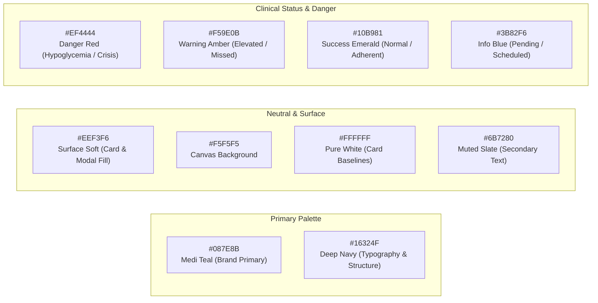
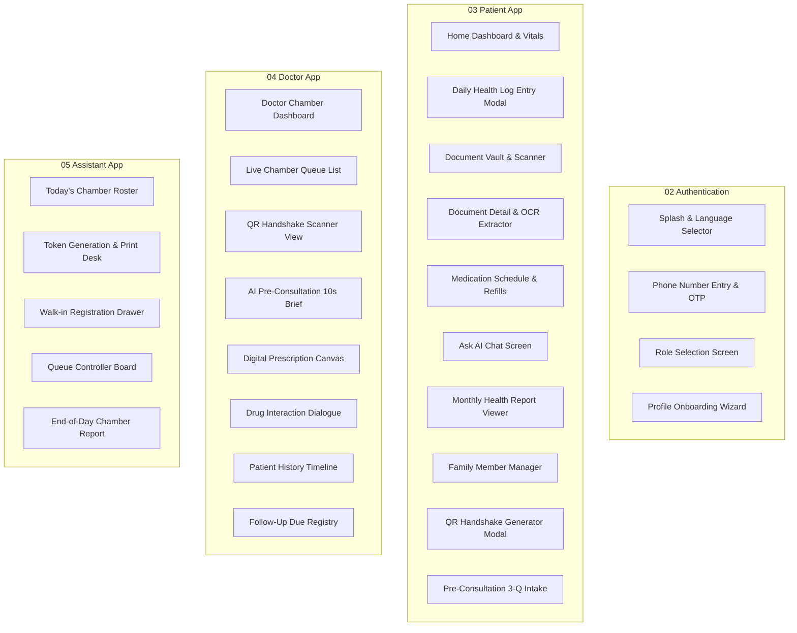

# MediVault — UI/UX Design System & Specification Document

> **Design Asset Source:** Figma Exported Vector Specifications (`/Designs/*.svg`)  
> **Platform Targets:** Web Prototype (React 18 + Tailwind CSS), Native Mobile (Flutter / React Native)  
> **Target Audience:** Patients, Doctors, and Clinic Chamber Assistants in Bangladesh

---

## 1. Design System Overview

The MediVault visual language is engineered specifically for clinical clarity, accessibility under high-stress medical conditions, and rapid visual comprehension by non-technical patients and busy healthcare providers.

### 1.1 Color Palette

The color system is derived directly from the canonical MediVault Figma Design System (`01 Design System.svg`).



#### Detailed Color Tokens

| Token Name | Hex Code | Tailwind Equivalent | Primary Application |
|---|---|---|---|
| `color-primary` | `#087E8B` | `teal-600` | Primary buttons, active tab icons, brand accents, timeline nodes |
| `color-primary-dark` | `#065A64` | `teal-800` | Pressed button states, high-contrast headers |
| `color-primary-light` | `#E0F2F1` | `teal-50` | Badge backgrounds, highlighted table rows, selected chips |
| `color-secondary` | `#16324F` | `slate-900` | Main headings, modal headers, navigation bar background |
| `color-surface` | `#EEF3F6` | `slate-100` | Container backgrounds, inactive cards, input field backgrounds |
| `color-canvas` | `#F5F5F5` | `gray-100` | Application root body background |
| `color-card` | `#FFFFFF` | `white` | Elevated clinical cards, dialogue boxes, prescription sheets |
| `color-text-main` | `#16324F` | `slate-900` | Primary body text and reading elements |
| `color-text-muted` | `#64748B` | `slate-500` | Subtitles, timestamps, unit labels (mmol/L, mmHg) |
| `color-danger` | `#DC2626` | `red-600` | Hypoglycemia (<3.9), Hyperglycemia (>16), BP Crisis (>180/120) |
| `color-danger-bg` | `#FEF2F2` | `red-50` | Danger alert banner container background |
| `color-warning` | `#D97706` | `amber-600` | Moderately elevated vitals, overdue follow-up, refill alert |
| `color-success` | `#059669` | `emerald-600` | Normal vitals range, taken medications, verified QR status |

---

### 1.2 Typography Hierarchy

MediVault utilizes a dual-font configuration:
- **Latin Characters:** `Inter`, `-apple-system`, `BlinkMacSystemFont`, `Segoe UI`, `Roboto`
- **Bangla Characters:** `Hind Siliguri`, `Noto Sans Bengali`

```
Display Large   : 32px / Line Height 40px / Bold (700)     — Top Dashboard Greetings, Big Numbers
Heading 1       : 24px / Line Height 32px / SemiBold (600) — Page Titles, Primary Section Headers
Heading 2       : 20px / Line Height 28px / SemiBold (600) — Card Titles, Modal Headers
Heading 3       : 16px / Line Height 24px / Medium (500)   — Metric Titles, Table Column Headers
Body Regular    : 14px / Line Height 20px / Regular (400)  — Main text, doctor remarks, instructions
Body Small      : 12px / Line Height 16px / Regular (400)  — Timestamps, secondary metadata, unit labels
Caption / Micro : 10px / Line Height 14px / Medium (500)   — Token serial tags, status badges
```

---

### 1.3 Spacing, Borders & Elevation

- **Spacing Scale:** Standard 4px base (`4px`, `8px`, `12px`, `16px`, `24px`, `32px`, `48px`)
- **Border Radii:**
  - `radius-sm`: `4px` (Tags, badges, small buttons)
  - `radius-md`: `8px` (Standard form inputs, action buttons)
  - `radius-lg`: `16px` (Clinical metric cards, timeline items, modals)
  - `radius-full`: `9999px` (Pills, user avatars, status indicators)
- **Elevation & Shadows:**
  - `shadow-subtle`: `0 1px 3px rgba(22, 50, 79, 0.05)` (Default card elevation)
  - `shadow-elevated`: `0 4px 12px rgba(22, 50, 79, 0.08)` (Active cards, dropdowns)
  - `shadow-modal`: `0 12px 32px rgba(22, 50, 79, 0.16)` (Dialogues, QR popup)

---

## 2. Screen Inventory & Architecture

Based on Figma Design exports:
- `00 Cover and Product Overview.svg`
- `02 Authentication and Onboarding.svg`
- `03 Patient App.svg`
- `04 Doctor App.svg`
- `05 Clinic Assistant App.svg`
- `06 Shared Workflows.svg`
- `07 Components and States.svg`
- `08 Flow Specifications.svg`
- `09 Feature Coverage Audit.svg`



---

## 3. Navigation Structures by Application Role

### 3.1 Patient Application Navigation

```
┌────────────────────────────────────────────────────────┐
│ Top Bar: [Family Switcher Dropdown]    [Alert Bell (2)]│
├────────────────────────────────────────────────────────┤
│                                                        │
│                    Active Screen View                  │
│                                                        │
├────────────────────────────────────────────────────────┤
│ Bottom Nav: [Home]  [Logs]  [Docs]  [Meds]  [Ask AI]   │
└────────────────────────────────────────────────────────┘
```

1. **Home Tab:** Quick vitals overview, next medication dose countdown, upcoming follow-up badge, quick "Share QR" floating button.
2. **Logs Tab:** Fasting/Post-meal glucose cards, BP blood pressure card with 30-day sparkline charts, "+ Log Vital" primary CTA.
3. **Docs Tab:** Filterable document timeline (Prescriptions, Diagnostic Labs, Radiology), floating camera icon for instant capture.
4. **Meds Tab:** Morning / Afternoon / Evening dose checklist with "Taken" toggle, refill remaining counters.
5. **Ask AI Tab:** Clean conversational messenger interface with prompt suggestions ("Analyze my last glucose trends", "ডায়াবেটিস নিয়ন্ত্রণে ডায়েট").

---

### 3.2 Doctor Application Navigation (Desktop / Tablet Optimized)

```
┌──────────────────────────────────────────────────────────────────────────┐
│ Top Bar: Prof. Dr. Nasreen Akhter | Chamber: Green Life (Chamber #402)   │
├───────────────────────┬──────────────────────────────────────────────────┤
│ Left Sidebar:         │ Main Clinical Stage:                             │
│ • [Live Queue (8)]    │  • Scanned Patient Profile & AI 10s Brief        │
│ • [Patient Registry]  │  • 90-Day Glucose / BP Trend Graph               │
│ • [Prescriptions]     │  • Digital Prescription Form (Drugs, Lab Orders) │
│ • [Follow-up Due (12)]│  • [Check Drug Interactions] [Finalize & Send]   │
│ • [Scan QR Code]      │                                                  │
└───────────────────────┴──────────────────────────────────────────────────┘
```

---

### 3.3 Clinic Assistant Navigation (Fast Desk Workflow)

```
┌──────────────────────────────────────────────────────────────────────────┐
│ Chamber: Dr. Nasreen | Session: Evening 5-9 PM | Total Seen: 14 | Left: 8│
├────────────────────────────────────────┬─────────────────────────────────┤
│ Left Column: Queue Manager             │ Right Column: Fast Actions      │
│ [Token #15 - Rafiqul Islam] In Chamber │ [+ New Walk-in Registration]    │
│ [Token #16 - Shirin Akter]  Next In Line│ [SMS Re-broadcast Token]        │
│ [Token #17 - Abdul Jalil]   Waiting    │ [Transfer Token to Doctor]      │
│ [Call Next] [Mark Done] [Mark No-Show] │ [Print Physical Token Slip]     │
└────────────────────────────────────────┴─────────────────────────────────┘
```

---

## 4. Key UI Components & Behavioral Specifications

### 4.1 Danger Alert Banner (`DangerBanner.tsx`)
Rendered persistently at the top of the patient dashboard when vitals exceed safety boundaries.

- **Hypoglycemia Alert:**
  - Container: Red fill (`#FEF2F2`), border 1.5px solid `#DC2626`.
  - Icon: Pulsing warning triangle with blood drop glyph.
  - Text: **"Danger: Low Blood Glucose Detected (3.4 mmol/L)"**
  - Subtext: *"Take 15g fast-acting sugar immediately (1/2 cup fruit juice or 3 sugar candies). Recheck in 15 mins."*
  - CTA: `[Emergency Call Doctor / Family]` (direct phone dial link).

### 4.2 Document OCR Processing Card (`DocumentTimelineCard.tsx`)
- **States:**
  - `Uploading`: Progress bar with percentage and cancel icon.
  - `Processing OCR`: Animated shimmer effect with text *"Scanning document and extracting clinical terms..."*.
  - `Completed`: Clean card displaying extracted Doctor Name, Clinic, Date, and pill tags for detected medications (e.g., `Tab. Metformin 500mg`, `Tab. Telmisartan 40mg`).
  - `Failed`: Amber border with *"Text unclear. Tap to retry or review manually."*

### 4.3 QR Consultation Handshake Modal (`QRHandshakeModal.tsx`)
- Displays high-contrast SVG QR code.
- Circular animated countdown timer showing remaining seconds (e.g. `29:45 remaining`).
- Clear text: *"Show this QR to your consulting doctor to grant temporary read-only access to your 90-day clinical record."*
- Real-time status indicator:
  - Yellow: `Waiting for doctor to scan...`
  - Green (Instant change on scan): `Connected with Dr. Nasreen Akhter (Valid for 30m)`

### 4.4 Drug-Drug Interaction Dialogue (`DrugInteractionModal.tsx`)
- Appears automatically if the doctor prescribes a medication that conflicts with active patient drugs.
- **Severity Levels:**
  - `Severe / Contraindicated` (Red): Requires typing an override reason before submission.
  - `Moderate` (Amber): Warning with suggested dose adjustment or monitoring note.
  - `Minor` (Blue): Informational disclaimer.

---

## 5. Responsive Design & Prototype Mapping

For the Phase 2 React.js prototype, the design is structured to be responsive across:
1. **Mobile Web (375px - 430px):** Emulates the Flutter/React Native patient experience with fixed bottom navigation.
2. **Tablet / iPad (768px - 1024px):** Ideal for the Clinic Assistant token desk.
3. **Desktop (1280px+):** Full multi-pane chamber layout for the Doctor Consultation desk and Digital Prescription canvas.

