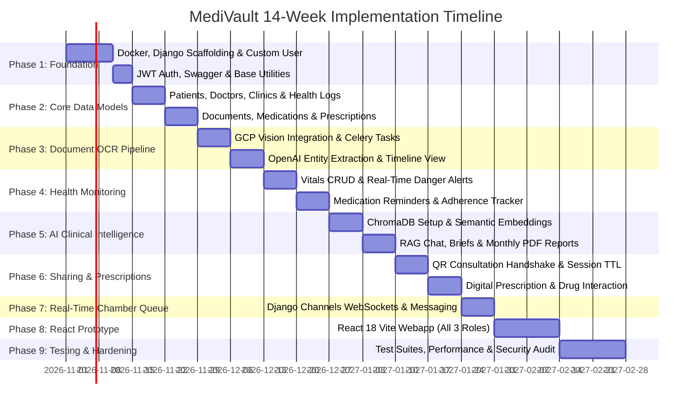

# MediVault — Project Implementation Guide

> **Target Engineering Roadmap:** 14-Week End-to-End Build  
> **Development Paradigm:** AI-Assisted Agile Development  
> **Repository Target:** Mono-repository containing `/backend` (Django) and `/frontend` (React.js Prototype)

---

## 1. Project Phase Overview



---

## 2. Phase 1: Foundation & Infrastructure (Weeks 1–2)

### Step 1.1: Project Directory Scaffolding
Run the following commands in PowerShell / Terminal:

```bash
# Create monorepo directories
mkdir backend frontend docs
cd backend

# Initialize Python Virtual Environment
python -m venv venv
.\venv\Scripts\activate

# Install core Django packages
pip install django djangorestframework djangorestframework-simplejwt django-cors-headers django-environ psycopg[binary] drf-spectacular celery redis channels channels-redis
```

### Step 1.2: Django Project Initialization
```bash
django-admin startproject config .
mkdir -p apps/accounts apps/patients apps/doctors apps/clinics apps/documents apps/health_logs apps/medications apps/prescriptions apps/appointments apps/sharing apps/ai_services apps/reports apps/notifications apps/common
```

### Step 1.3: Python Dependencies (`backend/requirements.txt`)
```text
Django>=5.0,<5.1
djangorestframework>=3.15.0
djangorestframework-simplejwt>=5.3.1
django-cors-headers>=4.3.1
django-environ>=0.11.2
drf-spectacular>=0.27.2
psycopg[binary]>=3.1.18
celery>=5.4.0
redis>=5.0.3
channels>=4.1.0
channels-redis>=4.2.0
daphne>=4.1.0
google-cloud-vision>=3.7.2
openai>=1.30.0
chromadb-client>=0.4.24
pillow>=10.3.0
weasyprint>=61.2
reportlab>=4.2.0
httpx>=0.27.0
pytest>=8.2.0
pytest-django>=4.8.0
factory-boy>=3.3.0
```

---

## 3. Phase 2: Core Data Models & Migrations (Weeks 2–3)

### Step 2.1: Implement Common Base Models (`apps/common/models.py`)
```python
import uuid
from django.db import models

class TimeStampedUUIDModel(models.Model):
    """Abstract base model providing UUID primary key and timestamp fields."""
    id = models.UUIDField(primary_key=True, default=uuid.uuid4, editable=False)
    created_at = models.DateTimeField(auto_now_add=True, db_index=True)
    updated_at = models.DateTimeField(auto_now=True)

    class Meta:
        abstract = True
```

### Step 2.2: Register Custom User in `config/settings/base.py`
```python
AUTH_USER_MODEL = 'accounts.User'
```

### Step 2.3: Run Initial Migrations
```bash
python manage.py makemigrations accounts patients doctors clinics documents health_logs medications prescriptions appointments sharing ai_services reports notifications
python manage.py migrate
```

---

## 4. Phase 3: Document Processing Pipeline (Weeks 3–4)

### Step 3.1: Document Upload ViewSet (`apps/documents/views.py`)
```python
from rest_framework import viewsets, status
from rest_framework.response import Response
from rest_framework.parsers import MultiPartParser, FormParser
from rest_framework.permissions import IsAuthenticated
from .models import MedicalDocument
from .serializers import MedicalDocumentSerializer
from .tasks import process_document_ocr_task

class MedicalDocumentViewSet(viewsets.ModelViewSet):
    serializer_class = MedicalDocumentSerializer
    permission_classes = [IsAuthenticated]
    parser_classes = [MultiPartParser, FormParser]

    def get_queryset(self):
        return MedicalDocument.objects.filter(patient__user=self.request.user)

    def perform_create(self, serializer):
        doc = serializer.save(
            patient=self.request.user.patient_profile,
            processing_status=MedicalDocument.ProcessingStatus.PENDING
        )
        # Dispatch async OCR Celery task
        process_document_ocr_task.delay(str(doc.id))
```

### Step 3.2: Celery OCR Task (`apps/documents/tasks.py`)
```python
from celery import shared_task
from .models import MedicalDocument, DocumentEntity
from apps.ai_services.ocr_service import OCRService
from apps.ai_services.openai_service import OpenAIService
from apps.ai_services.chroma_service import ChromaService

@shared_task(bind=True, max_retries=3)
def process_document_ocr_task(self, document_id):
    try:
        doc = MedicalDocument.objects.get(id=document_id)
        doc.processing_status = MedicalDocument.ProcessingStatus.PROCESSING_OCR
        doc.save(update_fields=['processing_status'])

        # 1. Google Cloud Vision OCR
        ocr_service = OCRService()
        ocr_result = ocr_service.extract_text_from_image(doc.file.path)
        doc.raw_ocr_text = ocr_result['raw_text']
        doc.processing_status = MedicalDocument.ProcessingStatus.EXTRACTING_AI
        doc.save(update_fields=['raw_ocr_text', 'processing_status'])

        # 2. OpenAI GPT-4o-mini Entity Extraction
        ai_service = OpenAIService()
        entities = ai_service.extract_clinical_entities(doc.raw_ocr_text)

        # 3. Save Structured Entities
        for med in entities.get('medications', []):
            DocumentEntity.objects.create(
                document=doc,
                entity_type=DocumentEntity.EntityType.MEDICATION,
                entity_name=med['brand_name'],
                entity_value=f"{med['strength']} - {med['dosage_pattern']}",
                raw_snippet=f"{med['brand_name']} {med['strength']} {med['dosage_pattern']} {med.get('timing_relation', '')}"
            )

        for diag in entities.get('diagnoses', []):
            DocumentEntity.objects.create(
                document=doc,
                entity_type=DocumentEntity.EntityType.DIAGNOSIS,
                entity_name=diag
            )

        # 4. Generate Semantic Vector in ChromaDB
        chroma = ChromaService()
        vector_id = chroma.index_document(
            doc_id=str(doc.id),
            patient_id=str(doc.patient.id),
            text=doc.raw_ocr_text,
            metadata={"date": str(doc.document_date), "type": doc.document_type}
        )
        doc.chroma_vector_id = vector_id
        doc.processing_status = MedicalDocument.ProcessingStatus.COMPLETED
        doc.save(update_fields=['chroma_vector_id', 'processing_status'])

    except Exception as exc:
        doc = MedicalDocument.objects.get(id=document_id)
        doc.processing_status = MedicalDocument.ProcessingStatus.FAILED
        doc.error_message = str(exc)
        doc.save(update_fields=['processing_status', 'error_message'])
        raise self.retry(exc=exc, countdown=15)
```

---

## 5. Phase 4: Health Monitoring & Danger Alert System (Weeks 4–5)

### Step 4.1: Danger Alert Detection Signal (`apps/health_logs/signals.py`)
```python
from decimal import Decimal
from django.db.models.signals import post_save
from django.dispatch import receiver
from .models import BloodGlucoseLog, BloodPressureLog, DangerAlert
from apps.notifications.tasks import send_emergency_sms_task

@receiver(post_save, sender=BloodGlucoseLog)
def check_blood_glucose_danger(sender, instance, created, **kwargs):
    if not created:
        return

    val = instance.glucose_value_mmol
    alert_type = None
    instruction = ""

    if val < Decimal('3.9'):
        alert_type = DangerAlert.AlertType.HYPOGLYCEMIA
        instruction = "Take 15g fast-acting sugar immediately (1/2 cup juice or 3 candies). Recheck in 15 mins."
    elif val > Decimal('16.0'):
        alert_type = DangerAlert.AlertType.HYPERGLYCEMIA
        instruction = "Critical high blood glucose. Drink water, monitor ketones, and contact physician if symptomatic."

    if alert_type:
        instance.is_danger = True
        instance.save(update_fields=['is_danger'])
        
        alert = DangerAlert.objects.create(
            patient=instance.patient,
            alert_type=alert_type,
            trigger_value=f"{val} mmol/L",
            instruction_text=instruction
        )
        # Dispatch emergency notification via MessagingService (Email in dev, SMS in prod)
        send_emergency_alert_task.delay(str(alert.id))
```

---

## 6. Phase 5: AI RAG & Monthly Reports (Weeks 5–7)

### Step 6.1: ChromaDB RAG Service (`apps/ai_services/chroma_service.py`)
```python
import chromadb
from django.conf import settings
from .openai_service import OpenAIService

class ChromaService:
    def __init__(self):
        self.client = chromadb.HttpClient(
            host=settings.CHROMA_HOST,
            port=settings.CHROMA_PORT
        )
        self.collection = self.client.get_or_create_collection(
            name="medivault_patient_documents",
            metadata={"hnsw:space": "cosine"}
        )
        self.ai = OpenAIService()

    def index_document(self, doc_id: str, patient_id: str, text: str, metadata: dict) -> str:
        embedding = self.ai.get_embedding(text[:4000])  # chunk to model limits
        metadata['patient_id'] = patient_id
        self.collection.add(
            ids=[doc_id],
            embeddings=[embedding],
            documents=[text[:2000]],
            metadatas=[metadata]
        )
        return doc_id

    def query_patient_records(self, patient_id: str, query_text: str, n_results: int = 4) -> list:
        query_embedding = self.ai.get_embedding(query_text)
        results = self.collection.query(
            query_embeddings=[query_embedding],
            n_results=n_results,
            where={"patient_id": patient_id}
        )
        return results['documents'][0] if results['documents'] else []
```

---

## 7. Phase 6: QR Consultation & Prescriptions (Weeks 7–8)

### Step 7.1: QR Generator & Validator (`apps/sharing/services.py`)
```python
import secrets
import hashlib
from datetime import timedelta
from django.utils import timezone
from .models import ConsultationShare

class SharingService:
    @staticmethod
    def generate_qr_share(patient_profile) -> tuple[str, ConsultationShare]:
        raw_token = secrets.token_urlsafe(32)
        token_hash = hashlib.sha256(raw_token.encode()).hexdigest()
        expires = timezone.now() + timedelta(minutes=30)

        share = ConsultationShare.objects.create(
            patient=patient_profile,
            token_hash=token_hash,
            expires_at=expires
        )
        return raw_token, share

    @staticmethod
    def validate_and_consume_token(raw_token: str, doctor_profile):
        token_hash = hashlib.sha256(raw_token.encode()).hexdigest()
        share = ConsultationShare.objects.filter(
            token_hash=token_hash,
            is_active=True,
            expires_at__gt=timezone.now()
        ).first()

        if not share:
            return None

        share.doctor = doctor_profile
        share.save(update_fields=['doctor'])
        return share
```

---

## 8. Phase 7: Real-Time Chamber Queue WebSockets (Weeks 8–9)

### Step 8.1: Queue Consumer (`apps/appointments/consumers.py`)
```python
import json
from channels.generic.websocket import AsyncWebsocketConsumer

class ClinicQueueConsumer(AsyncWebsocketConsumer):
    async def connect(self):
        self.clinic_id = self.scope['url_route']['kwargs']['clinic_id']
        self.room_group_name = f'queue_clinic_{self.clinic_id}'

        await self.channel_layer.group_add(
            self.room_group_name,
            self.channel_name
        )
        await self.accept()

    async def disconnect(self, close_code):
        await self.channel_layer.group_discard(
            self.room_group_name,
            self.channel_name
        )

    async def queue_update(self, event):
        """Receive broadcast from channel layer and forward to WebSocket client."""
        await self.send(text_data=json.dumps(event['payload']))
```

---

## 9. Phase 8: React.js Prototype Frontend (Weeks 9–12)

### Step 9.1: Frontend Package Config (`frontend/package.json`)
```json
{
  "name": "medivault-frontend",
  "private": true,
  "version": "1.0.0",
  "type": "module",
  "scripts": {
    "dev": "vite",
    "build": "tsc && vite build",
    "lint": "eslint . --ext ts,tsx --report-unused-disable-directives --max-warnings 0",
    "preview": "vite preview"
  },
  "dependencies": {
    "@tanstack/react-query": "^5.32.0",
    "axios": "^1.6.8",
    "lucide-react": "^0.378.0",
    "qrcode.react": "^3.1.0",
    "react": "^18.3.1",
    "react-dom": "^18.3.1",
    "react-router-dom": "^6.23.0",
    "recharts": "^2.12.7",
    "tailwind-merge": "^2.3.0"
  },
  "devDependencies": {
    "@types/react": "^18.3.1",
    "@types/react-dom": "^18.3.0",
    "@vitejs/plugin-react": "^4.2.1",
    "autoprefixer": "^10.4.19",
    "postcss": "^8.4.38",
    "tailwindcss": "^3.4.3",
    "typescript": "^5.4.5",
    "vite": "^5.2.11"
  }
}
```

---

## 10. Phase 9: Testing, Security Hardening & Production Audit (Weeks 13–14)

### Step 10.1: Pytest Test Suite Configuration (`backend/pytest.ini`)
```ini
[pytest]
DJANGO_SETTINGS_MODULE = config.settings.development
python_files = tests.py test_*.py *_tests.py
addopts = --reuse-db --nomigrations --cov=apps --cov-report=html --cov-report=term-missing
```

### Step 10.2: Model Factory Example (`backend/tests/factories.py`)
```python
import factory
from apps.accounts.models import User
from apps.patients.models import PatientProfile
from apps.health_logs.models import BloodGlucoseLog

class UserFactory(factory.django.DjangoModelFactory):
    class Meta:
        model = User
    phone_number = factory.Sequence(lambda n: f'+8801710{n:06d}')
    email = factory.LazyAttribute(lambda o: f'{o.phone_number.replace("+", "")}@example.com')
    full_name = "Test Patient"
    role = User.Role.PATIENT
    is_phone_verified = True

class PatientProfileFactory(factory.django.DjangoModelFactory):
    class Meta:
        model = PatientProfile
    user = factory.SubFactory(UserFactory)
    allergies = "None reported"

class BloodGlucoseLogFactory(factory.django.DjangoModelFactory):
    class Meta:
        model = BloodGlucoseLog
    patient = factory.SubFactory(PatientProfileFactory)
    glucose_value_mmol = 5.4
    context = BloodGlucoseLog.MeasurementContext.FASTING
```

---

## 11. Verification & Quality Gates

Each phase requires passing specific quality gates before proceeding:
1. **Model Check:** `python manage.py check --deploy` passes with 0 critical warnings.
2. **Migration Sanity:** `python manage.py makemigrations --check` detects no unstaged model changes.
3. **Test Suite:** `pytest` passes with `> 80%` test coverage on all serializers and permission classes.
4. **Linting:** `flake8` on backend and `npm run lint` on frontend pass with 0 errors.
5. **WebSocket Verification:** Channels consumers pass asynchronous tests via `WebsocketCommunicator`.
6. **Task Verification:** Celery tasks execute without unhandled exceptions in eager test mode.

