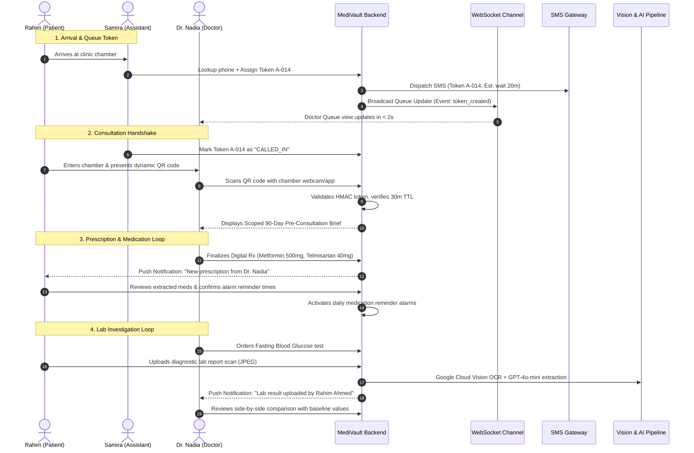

# MediVault — Product Requirements Document (PRD)

> **Document Version:** 2.0.0 (Master Unified Specification)  
> **Date:** October 2026  
> **Target Region:** Bangladesh Healthcare Ecosystem (`Asia/Dhaka`, BDT)  
> **Sources:** `Project_Proposal.txt`, `Feature_List.txt`, Figma Vector Specifications (`Designs/00–09.svg`)  
> **Target Stack:** Django 5.x REST Framework (ASGI/WSGI), PostgreSQL 16 with `pgvector`, React 18+ (Prototype), Flutter / React Native (Production), Google Cloud Vision API, OpenAI GPT-4o-mini

---

## 1. Problem Statement & Healthcare Reality

Healthcare in Bangladesh is highly fragmented across private chambers, public hospitals, diagnostic centers, and paper-based records. A patient may consult multiple general practitioners and specialists over decades, receiving paper prescriptions and physical diagnostic reports (often on thermal or poor-quality paper). 

### Key Friction Points
1. **The Chamber Rush:** In outpatient clinics, physicians see 30–80 patients in an evening session, leaving only 3 to 7 minutes per consultation.
2. **Patient as Data Courier:** Patients or their family caregivers must remember previous diagnoses, current dosages, historical fasting glucose values, and drug allergies. When files are misplaced or left at home, doctors practice without critical context.
3. **Language & Digital Divide:** Prescriptions and lab reports are printed in English, while patient comprehension, daily thinking, and home caregiving occur in Bangla.
4. **Queue Chaos:** Physical token distribution in clinic waiting lobbies leads to disputes over serials, unverified wait times, and constant interruptions of the doctor.

---

## 2. Vision, Goals & Explicit Non-Goals

**Vision:** One unified, trusted health record connecting **Patients**, **Doctors**, and **Clinic Assistants** for everyday care in Bangladesh.

### 2.1 Measurable Product Goals

| Goal | Target Metric |
|---|---|
| **G1: Documents to Usable History** | $\ge 80\%$ of uploaded prescriptions and diagnostic reports reach a structured, user-confirmed record. |
| **G2: Fast In-Chamber Review** | Consulting doctor accesses a scoped pre-consultation brief in $< 10\text{ s}$ after QR handshake. |
| **G3: Patient Data Sovereignty** | $100\%$ of record shares are scoped, expiring (30-minute default), revocable, and audit-logged. |
| **G4: Predictable Clinic Days** | Queue state is synchronized across Assistant, Doctor, and Patient devices in $< 2\text{ s}$ via WebSockets. |
| **G5: Zero AI Hallucination in Clinical Metrics** | Zero invented numerical values; all mathematical averages computed deterministically in code; all AI text clearly labeled with source document citations. |

### 2.2 Explicit Non-Goals (Scope Boundaries)
- **No Automated Diagnosis:** MediVault shall never provide differential diagnoses, suggest medical treatments, or advise catch-up medication doses.
- **No Direct Telemedicine / Video Calls (v1):** The platform is designed for physical in-chamber care and record organization.
- **No In-App Payments / e-Pharmacy (v1):** Medication purchase and financial transactions are deferred to future iterations.
- **No Unvetted Drug Interaction Claims:** The platform will never declare a drug combination "safe" without a medically certified reference source.
- **No Blind Family-Wide Record Sharing:** Sharing permissions apply strictly to designated individual family member profiles, never the entire family account.
- **Development Notification Strategy (Zero SMS Cost):** During initial development and prototyping, all OTP verification codes, queue token alerts, danger alerts, and follow-up reminders are routed via **SMTP Email** (`MESSAGING_BACKEND=email`). This avoids expensive third-party SMS gateway fees in Bangladesh during development, with an architectural toggle to SMS (`MESSAGING_BACKEND=sms`) when moving live.

---

## 3. Core Personas & Access Boundaries

| Persona | Context & Environment | Core Needs & Permissions |
|---|---|---|
| **Rahim Ahmed** (45, Dhaka)<br/>*Patient / Family Caregiver* | Manages his own Type 2 Diabetes and Hypertension, plus his elderly mother's prescriptions. Uses Android; reads Bangla and English. | • Phone OTP sign-in (no password fatigue)<br/>• Fast document capture with camera<br/>• Clear Bangla/English medication reminders<br/>• Scoped QR sharing with doctor<br/>• "Ask AI" over personal records |
| **Prof. Dr. Nasreen Akhter** (52, Dhaka)<br/>*Consultant Physician* | High-volume evening chamber (40+ patients in 3 hours) at Green Life Medical Chambers. Works on tablet/desktop. | • 10-second pre-consultation brief (90-day averages)<br/>• Fast digital prescription canvas with typeahead<br/>• Live chamber queue view<br/>• Notification when ordered lab tests are uploaded |
| **Kamrul Hasan** (24, Dhaka)<br/>*Clinic Front Desk Assistant* | Handles walk-in arrivals, telephone bookings, and waiting room crowd management. | • Fast phone number search (duplicate prevention)<br/>• Sequential token generation (`A-012`)<br/>• 1-click SMS serial notifications<br/>• Live synchronization with doctor's desk<br/>• **Identity-only access: Zero access to patient medical records** |

---

## 4. Fundamental Product Principles (Normative Rules)

Every feature implemented in MediVault must comply with these nine principles:

| # | Principle | Testable Engineering Rule |
|:---:|---|---|
| **PR1** | **Provenance Visible** | Every clinical datum must store and render its provenance origin: `MANUAL_ENTRY`, `OCR_EXTRACTED`, or `CLINICIAN_AUTHORED`. |
| **PR2** | **Scope Explicit** | Sharing authorizations must contain explicit arrays of permitted document/metric IDs. APIs must reject queries outside authorized scope. |
| **PR3** | **Unknown is Unknown** | Null values must render as *"Not recorded"* or *"Unavailable"*. Never default, impute, or guess clinical values. |
| **PR4** | **Original Preserved** | Scanned document originals (images/PDFs) are always permanently stored and viewable side-by-side with extracted data. |
| **PR5** | **Decoupled States** | Document OCR, notification delivery, reminder activation, and prescription saves have independent, explicit state fields. |
| **PR6** | **Strict AI Boundaries** | Prompts and output schemas strictly forbid diagnosis, dosage advice, or treatment changes. Refusal test suites required. |
| **PR7** | **Clinical Alerts First** | Danger alert thresholds are clinically approved; direct safety guidance and emergency contact (**999**) appear before any AI text. |
| **PR8** | **Least Privilege RBAC** | Enforce role and object-level permissions on every endpoint. Clinic assistants can only view identity and queue state, never clinical history. |
| **PR9** | **Bilingual Coexistence** | UI supports English and Bangla (`Noto Sans Bengali`). Standard clinical units (e.g. `mmol/L`, `mmHg`) remain in English for medical safety. |

---

## 5. Functional Requirements by Module

> **Screen Codes:** Reference Figma vector frames in `/Designs/` (`P` = Patient App, `D` = Doctor App, `A` = Assistant App, `S` = Shared Workflows).

### 5.1 Authentication & Onboarding (`AUTH`) — Screens `P01–P04g`

| ID | Requirement | Pri | Description & Acceptance Criteria |
|---|---|:---:|---|
| **AUTH-1** | Splash & Value Onboarding | **P0** | 4-step skippable carousel: Personal Health $\rightarrow$ Document Vault $\rightarrow$ Secure Sharing $\rightarrow$ Ask AI (`P01–P02`). |
| **AUTH-2** | Phone & Email OTP Authentication | **P0** | Primary login via Bangladesh mobile number (`+880 1XXXXXXXXX`) with optional email. During development/prototype phase, 6-digit OTP is delivered via SMTP Email (`MESSAGING_BACKEND=email`) to minimize third-party SMS costs; switches to SMS gateway (`MESSAGING_BACKEND=sms`) for production. 60-second resend countdown (`P03–P03c`). |
| **AUTH-3** | Validation & Help States | **P0** | Inline validation for incomplete numbers, expired OTPs, rate-limiting after 3 failed attempts, "Get Sign-in Help" flow (`P03d–P03g`). |
| **AUTH-4** | Versioned Terms & Privacy | **P0** | Plain-language consent summary. Stored with timestamp and version. Account consent $\ne$ clinical sharing consent (`P04`). |
| **AUTH-5** | Role Selection & Access Gate | **P0** | Displays Patient (`Available`), Doctor (`Requires BMDC Verification`), Assistant (`Requires Clinic Approval`). Unverified roles blocked (`P04a`). |
| **AUTH-6** | Patient Profile Setup | **P0** | Full name, DOB/age, gender, location, blood group, known allergies (`P04b`). Default for allergies: *"None reported"*. |
| **AUTH-7** | Doctor Professional Verification | **P0** | Name, BM&DC registration number, qualifications, clinic affiliation. Enters `PENDING_VERIFICATION` state until reviewed (`P04c/d`). |
| **AUTH-8** | Assistant Clinic Affiliation | **P0** | Selects clinic branch; requires doctor/admin confirmation before desk access is granted (`P04e/f`). |
| **AUTH-9** | Secure Role Switching | **P0** | Switching from patient to doctor profile requires fresh OTP confirmation. Explicit logout dialogue (`P04g`). |

---

### 5.2 Family Health Manager (`FAM`) — Screen `P06`

| ID | Requirement | Pri | Description & Acceptance Criteria |
|---|---|:---:|---|
| **FAM-1** | Multiple Profiles under One Account | **P0** | Master account can add up to 8 family member profiles (parents, children, spouse) with isolated records, vitals, and documents (`P06`). |
| **FAM-2** | Global Active Profile Header | **P0** | Top navigation bar displays active member avatar and name. Switching active member re-scopes all logs, documents, and notifications (`P06a`). |
| **FAM-3** | Caregiver Delegation | **P1** | Designated caregiver permissions with explicit read/write privileges per family profile (`P06b`). |
| **FAM-4** | Unified Family Alert Feed | **P1** | Notification center aggregates upcoming doses, follow-ups, and danger alerts across all members with clear member tag labels (`P06c`). |
| **FAM-5** | Isolated Sharing Boundaries | **P0** | Generating a QR consultation code never shares the entire family account; strictly bounded to the selected family member. |

---

### 5.3 Daily Health Log (`LOG`) — Screens `P07–P11`, `P28`

| ID | Requirement | Pri | Description & Acceptance Criteria |
|---|---|:---:|---|
| **LOG-1** | Blood Glucose Logging | **P0** | Capture value in `mmol/L` (or `mg/dL`), measurement context (`FASTING`, `POST_MEAL`, `BEDTIME`, `RANDOM`), timestamp, and notes (`P08`). |
| **LOG-2** | Blood Pressure & Pulse | **P0** | Systolic / Diastolic in `mmHg`, pulse in `bpm`. Automatic normal/elevated/crisis categorization (`P09`). |
| **LOG-3** | Weight & Vitals | **P0** | Body weight in `kg`, calculated BMI trend, heart rate tracking (`P10`). |
| **LOG-4** | Symptom Log | **P0** | Symptom tags (e.g. Dizziness, Tremor, Headache), severity scale (Mild, Moderate, Severe), onset time (`P11`). |
| **LOG-5** | Hard Physiological Limits | **P0** | Input validation rejects typos (e.g. Glucose $<0.5$ or $>60\text{ mmol/L}$; Systolic $<40$ or $>300\text{ mmHg}$). Invalid values never trigger danger alerts. |
| **LOG-6** | Longitudinal Trend Charts | **P0** | Interactive 7-day, 30-day, and 90-day time-series graphs with individual data points and visual gap indicators for missed days (`P07`, `P28`). |

---

### 5.4 Document Vault & OCR Pipeline (`DOC`) — Screens `P12–P19`

| ID | Requirement | Pri | Description & Acceptance Criteria |
|---|---|:---:|---|
| **DOC-1** | Categorized Document Feed | **P0** | Filterable list: `Prescriptions`, `Diagnostic Labs`, `Radiology`, `Discharge Summaries`, `Other` (`P12`). |
| **DOC-2** | Multi-Source Document Upload | **P0** | Camera capture with edge-detection, gallery image picker, or multi-page PDF upload (`P13–P14`). Tagged with encounter date, member, and type. |
| **DOC-3** | Capture Review & Optimization | **P1** | Retake, crop, rotate, multi-page add, and basic blur/contrast readability check before upload (`P14a/b`). |
| **DOC-4** | 5-Stage Processing Engine | **P0** | Explicit states: `uploaded` $\rightarrow$ `image_prepared` $\rightarrow$ `ocr_complete` $\rightarrow$ `entities_extracted` $\rightarrow$ `ready_for_review` (see §9.1) (`P15`). |
| **DOC-5** | Side-by-Side Verification Screen | **P0** | Original scan displayed adjacent to unverified extracted text fields. Patient confirms or edits uncertain values (`P16`). |
| **DOC-6** | Document Date Decoupling | **P0** | `document_date` (encounter date on paper) is stored separately from `upload_timestamp`. Extracted data marked `user_confirmed` (`P16a`). |
| **DOC-7** | Unified Document Viewer | **P0** | High-res zoomable scan, clinical entities, issuing doctor, raw OCR toggle, share, and delete actions (`P17–P18`). |
| **DOC-8** | Chronological Clinical Timeline | **P0** | Master longitudinal feed integrating documents, doctor visits, and danger vital events (`P19`). |
| **DOC-9** | Semantic Vector Search | **P0** | OCR text chunked and indexed in `pgvector` for conversational retrieval (`P19a`). |

---

### 5.5 Medications & Adherence (`MED`) — Screens `P20–P21`

| ID | Requirement | Pri | Description & Acceptance Criteria |
|---|---|:---:|---|
| **MED-1** | Medication Center | **P0** | Distinct sections: `Active Prescribed Medications` vs `Unverified Extracted Medications` (kept separate until patient review) (`P20`). |
| **MED-2** | Clinical Medication Detail | **P0** | Brand name, generic name, strength, dosage pattern (`1+0+1`), food relation (`After Food`), duration, source prescription link (`P20a`). |
| **MED-3** | Customizable Dose Reminders | **P0** | Patient can adjust alarm reminder times (e.g. 08:30 AM) without altering the doctor's clinical prescription frequency (`P20b`). |
| **MED-4** | Adherence Action Logging | **P0** | Dose actions: `Taken` (records actual timestamp), `Skipped` (requires reason), `Snoozed`. **Explicitly forbids catch-up dose advice** (`P20c`). |
| **MED-5** | Adherence Score Calculation | **P0** | Percentage calculated as $\frac{\text{Doses Taken}}{\text{Scheduled Doses}}$ over completed days. Denominator explicitly stated; in-progress day excluded (`P20d`). |
| **MED-6** | Refill Anticipation Alert | **P1** | Automatic alert when 5 days of medication remain based on duration and taken counts (`P21`). |

---

### 5.6 Appointments, Memory & Pre-Intake (`APT`) — Screens `P22–P25`

| ID | Requirement | Pri | Description & Acceptance Criteria |
|---|---|:---:|---|
| **APT-1** | Appointment Hub | **P0** | Upcoming and past appointments with doctor name, clinic address, and chamber time (`P22`). |
| **APT-2** | Follow-Up Date Memory | **P0** | Automatically extracts return advice from prescriptions (e.g. *"Review after 3 months"*) and populates calendar target (`P23`). |
| **APT-3** | Escalated Reminder Sequence | **P1** | Three-stage proactive notifications: **2.5 months prior** $\rightarrow$ **1 week prior** $\rightarrow$ **Due date** (`P23a`). |
| **APT-4** | 3-Question Pre-Consultation Intake | **P0** | Guided questions: (1) Main concern today, (2) New or worsening symptoms, (3) Issues with current medicines (`P24`). |
| **APT-5** | AI Pre-Appointment Brief | **P1** | Synthesizes intake responses with 90-day vitals into a 1-page summary. Clearly labeled: *AI-Generated Clinical Synthesis* (`P25`). |

---

### 5.7 Ask AI Clinical Records Assistant (`AI`) — Screens `P26–P27`

| ID | Requirement | Pri | Description & Acceptance Criteria |
|---|---|:---:|---|
| **AI-1** | RAG Query over Records | **P0** | Grounded retrieval over active member's documents and logs. Every answer cites source document, doctor, and date. Refuses if not found (`P26`). |
| **AI-2** | General Health Education | **P1** | Clearly labeled "General Education". Answers wellness questions in simple Bangla/English. Forbids personalized treatment advice (`P26a`). |
| **AI-3** | Lab Report Explainer | **P0** | Explains test purposes and reported ranges without inventing missing reference values (`P27`). |
| **AI-4** | Comparable Analyte History | **P1** | Allows side-by-side comparison only for identical lab analytes and units across dated reports (`P27a`). |
| **AI-5** | Dynamic Bilingual Response | **P0** | Automatically detects input language and responds in natural Bengali or clear English (`P26b`). |

---

### 5.8 Monthly Health Portfolio (`RPT`) — Screens `P28–P30`

| ID | Requirement | Pri | Description & Acceptance Criteria |
|---|---|:---:|---|
| **RPT-1** | Automated Monthly Generation | **P1** | Scheduled generation on the **1st of every month** summarizing the preceding calendar month (`P28`). |
| **RPT-2** | Data Completeness Check | **P1** | Displays total log counts; triggers "Insufficient Data" layout if $< 5$ readings exist; never invents summaries (`P28a`). |
| **RPT-3** | Trend Visualizations | **P1** | Glucose averages (fasting vs post-meal), BP trends, weight change, medication adherence score (`P29`). |
| **RPT-4** | Grounded Narrative Paragraph | **P1** | LLM-generated summary paragraph with all numbers injected deterministically from database calculations (`P29a`). |
| **RPT-5** | Downloadable PDF Export | **P1** | Clean vector PDF with clinical header, patient identity, and QR verification link (`P30`). |
| **RPT-6** | Expiring Shareable Link | **P1** | Web link with configurable expiry (24h/7d) and instant patient revocation toggle (`P30a`). |
| **RPT-7** | Decoupled Generation vs Delivery | **P1** | PDF generation status (`generated`) is tracked independently from push notification delivery (`delivered`) (`P30b`). |

---

### 5.9 Algorithmic Danger Alerts (`ALR`) — Screen `P31`

| ID | Requirement | Pri | Description & Acceptance Criteria |
|---|---|:---:|---|
| **ALR-1** | Clinical Danger Thresholds | **P0** | Triggered immediately when: Glucose $< 3.9\text{ mmol/L}$ (Hypoglycemia), Glucose $> 16.0\text{ mmol/L}$ (Hyperglycemia), or BP $> 180\text{ Systolic}$ **OR** $> 120\text{ Diastolic}$ (Crisis). |
| **ALR-2** | Immediate Actionable Guidance | **P0** | High-contrast banner appears instantly. Suggests fast-acting sugar or urgent care / **999** emergency call. **Never delayed by AI calls** (`P31`). |
| **ALR-3** | Transparent Trigger Context | **P0** | Displays exact recorded value, timestamp, threshold rule, and clinical reason (`P31a`). |
| **ALR-4** | User Acknowledgment & History | **P0** | Action button: "I have seen this / Taken action". Recorded as `acknowledged` (never assumes patient is "cured") (`P31b`). |
| **ALR-5** | Rejection of Invalid Data | **P0** | Out-of-bounds typo values (e.g. Glucose = 300 mmol/L) are rejected by form validation and never generate emergency alerts. |

---

### 5.10 Ephemeral QR Consultation Handshake (`QR`) — Screens `P33*, D04*, D05*`

| ID | Requirement | Pri | Description & Acceptance Criteria |
|---|---|:---:|---|
| **QR-1** | Scoped Record Authorization | **P0** | Patient selects scope (`Last 90 Days` or `Specific Documents`) for **one member profile**. Read-only access (`P33a`). |
| **QR-2** | Dynamic QR Display & Timer | **P0** | High-contrast QR with animated countdown timer (default: 30 minutes). Instant "Revoke Access" button (`P33b–f`). |
| **QR-3** | Doctor Handshake Authentication | **P0** | Doctor scans QR code $\rightarrow$ backend validates cryptographic token $\rightarrow$ unlocks read session (`D04/D04a/b`). |
| **QR-4** | Comprehensive Failure Handling | **P0** | Explicit states for `Invalid Token`, `Token Expired`, `Revoked by Patient`, and `Unauthorized Doctor` (`D04c`). |
| **QR-5** | Scoped Pre-Consultation Brief | **P0** | Brief generated strictly using the authorized records. Access to wider history requires separate patient authorization (`D05a`). |
| **QR-6** | Revocation Enforcement | **P0** | Revocation instantly destroys session key in Redis, blocking future queries. Explains that previously printed copies cannot be recalled (`P33c/d`). |
| **QR-7** | Immutable Access Audit Trail | **P0** | Logs doctor's BM&DC registration, chamber IP address, timestamp, and accessed document IDs (`P33e`). |

---

### 5.11 Doctor Clinical Suite (`DOC-APP`) — Screens `D01–D14`

| ID | Requirement | Pri | Description & Acceptance Criteria |
|---|---|:---:|---|
| **DR-1** | Clinical Dashboard | **P0** | Live chamber queue summary, pending lab test reviews, scheduled follow-ups, and recent patient encounters (`D01`). |
| **DR-2** | Patient Registry & Longitudinal Search | **P0** | Search authorized patients by mobile number or name. Chronological timeline of visits and prescriptions (`D02–D03`). |
| **DR-3** | 10-Second Pre-Consultation Brief | **P0** | Displays 90-day glucose/BP averages, active drugs with adherence rates, and anomaly flags (`D05`). |
| **DR-4** | Consultation Workspace | **P0** | Multi-column clinical interface: previous records, patient logs, digital prescription canvas, investigation orders (`D07`). |
| **DR-5** | Digital Prescription Writer | **P0** | Typeahead medication library, standardized dosage forms, frequency, duration, chief complaints, and follow-up advice (`D08`). |
| **DR-6** | Honest Drug Interaction Review | **P0** | Flags potential interactions. If no validated pharmacology database is connected, displays: *"Checking unavailable — verify manually"* (`D09`). |
| **DR-7** | Prescription Confirmation & Sync | **P0** | Final preview (`D10`) $\rightarrow$ saves prescription $\rightarrow$ syncs to patient app $\rightarrow$ auto-creates medication schedules upon patient review (`D10a/b`). |
| **DR-8** | In-Chamber Lab Orders | **P0** | Doctor orders lab investigations (e.g. HbA1c, Lipid Profile) with instructions (`D07a`). |
| **DR-9** | Lab Upload Notification Loop | **P1** | Push alert when patient uploads diagnostic report for an investigation ordered by this doctor (`D11`). |
| **DR-10** | Overdue Follow-Up Monitor | **P1** | Filterable list of chronic patients overdue for scheduled review (`D12`). |
| **DR-11** | On-Demand Referral Report | **P1** | Generates standardized referral summary PDF respecting patient-approved scope (`D13`). |
| **DR-12** | Synchronized Chamber Queue | **P0** | Identical live queue snapshot matching the clinic assistant's token desk (`D06`). |

---

### 5.12 Clinic Assistant & Queue Suite (`ASST`) — Screens `A01–A09`

| ID | Requirement | Pri | Description & Acceptance Criteria |
|---|---|:---:|---|
| **AS-1** | Chamber Reception Dashboard | **P0** | Daily appointment overview, active queue summary, completed visit counts, and chamber running status (`A01`). |
| **AS-2** | Appointment Roster | **P0** | Filterable list: `All`, `Pre-booked`, `Waiting`, `In Consultation`, `Completed` (`A02`). |
| **AS-3** | Walk-in Search & Registration | **P0** | **Mandatory phone number lookup first** to prevent duplicate patient profiles. Creates new identity only if not found (`A03, A03a/b`). |
| **AS-4** | Sequential Token Generation | **P0** | Generates unique daily token (e.g. `A-012`). Calculates dynamic estimated wait time based on completed visit averages (`A04/A04a`). |
| **AS-5** | Queue State Transitions with Undo | **P0** | Actions: `Call In`, `Mark In Chamber`, `Mark Done`, `No Show`. **Includes "Undo Call In"** with audit trail (`A05`). |
| **AS-6** | Strict Identity-Only Registration | **P0** | Assistant confirmation displays patient name, phone, age, and token. **Zero clinical data or diagnoses visible** (`A06`). |
| **AS-7** | SMS Lifecycle Dispatch | **P0** | Preview SMS with token and wait estimate. Tracks honest status: `Prepared` $\rightarrow$ `Submitted` $\rightarrow$ `Delivered` / `Failed` (`A07/A07a`). |
| **AS-8** | End-of-Day Chamber Analytics | **P0** | Total registered, completed, no-shows, and average consultation duration. Shows *"Unavailable"* if timestamps are incomplete (`A08`). |
| **AS-9** | Chamber Session Controls | **P0** | Patient registry lookup (identity only), printer settings, session closing confirmation (`A09–A09c`). |

---

## 6. Shared Bridge Workflows



---

## 7. Normative State Machines

Every status in MediVault is decoupled and managed by an explicit finite state machine.

### 7.1 Document Processing Pipeline
```
[uploaded]
    │
    ▼
[image_prepared]
    │
    ▼
[ocr_complete] ───────────────► [ocr_failed] (retry available)
    │
    ▼
[entities_extracted] ─────────► [extraction_partial]
    │
    ▼
[ready_for_review]
    │
    ├──► [user_confirmed]
    ├──► [user_corrected]
    └──► [rejected_discarded]
```

### 7.2 Chamber Queue State Machine
```
[registered (waiting)]
    │
    ▼  (Undo: called -> waiting)
[called] ◄────────────────┐
    │                     │
    ├──► [in_chamber]     │
    │         │           │
    │         ▼           │
    ├──► [completed]      │
    └──► [no_show] ───────┘
```

### 7.3 SMS Notification Lifecycle
```
[prepared]
    │
    ▼
[submitted_to_gateway]
    │
    ├──► [delivered] (only if gateway provides delivery receipt)
    ├──► [delivery_unknown] (timeout / no receipt)
    └──► [failed] (retry available)
```

### 7.4 Digital Prescription Downstream States
```
Prescription Saved (DB Commit)
    │
    ├──► Patient Notification:   [pending] ──► [sent] ──► [failed]
    ├──► Clinical Extraction:    [pending] ──► [unverified] ──► [patient_reviewed]
    └──► Medication Reminders:   [not_activated] ──► [activated (post-review)]
```

### 7.5 QR Consultation Share Grant
```
[active (TTL: 1800s)]
    │
    ├──► [consumed_by_doctor] (session active)
    ├──► [expired] (timeout reached)
    └──► [revoked_by_patient] (instant purge from Redis)
```

---

## 8. AI Behavioral Specifications & Guardrails

| AI Capability | Model / Engine | Output Schema | Safety Boundary & Hard Constraint |
|---|---|---|---|
| **Document OCR** | Google Cloud Vision API | Clean UTF-8 text with confidence scores | Always preserves original image; flags low-confidence text for human review. |
| **Entity Extraction** | GPT-4o-mini | Structured JSON matching clinical schema | Never fills missing attributes; missing fields set to `null` with `unverified` status. |
| **Ask AI (Records)** | GPT-4o-mini + `pgvector` | Natural language answer with document citation chips | Refuses to answer if facts are absent from retrieved context chunks. No diagnosis. |
| **Ask AI (Education)** | GPT-4o-mini | Labelled "General Education" in Bangla/English | Appends mandatory clinical disclaimer; forbids personalized dosage or drug changes. |
| **Pre-Appt Synthesis** | GPT-4o-mini | Structured summary bullet points | Only accesses authorized family member's data; explicitly labeled as AI synthesis. |
| **Doctor 10s Brief** | Deterministic SQL/Python + GPT-4o-mini | 90-day averages, trends, active drugs, flags | **All numbers, averages, and counts are calculated in code**, never by LLM. |
| **Monthly Summary** | GPT-4o-mini | Single narrative paragraph | Injects pre-calculated metrics; explicitly highlights missing data and gaps. |

---

## 9. Non-Functional Requirements (NFRs)

- **API Performance:** 95% of non-AI requests respond in $< 250\text{ ms}$; OCR extraction in $< 45\text{ s}$; AI chat in $< 6\text{ s}$; WebSocket queue events in $< 1.5\text{ s}$.
- **Availability & Resilience:** $99.5\%$ target uptime. When OCR or OpenAI is down, documents save with `PENDING_MANUAL_REVIEW` status; never fake success.
- **Data Privacy & Redaction:** PII (patient phone numbers, national IDs) is redacted before payload transmission to external LLM providers.
- **Timezone Standardization:** All database records stored in UTC; all user-facing views rendered in Bangladesh Standard Time (`Asia/Dhaka`, UTC+6).
- **Accessibility:** Minimum touch target size 48px (44px minimum for micro-chips); color-contrast compliant with WCAG AA; optimized for 375px mobile viewports.

---

## 10. Design-vs-Feature-List Reconciliations

This table documents explicit design choices resolving discrepancies between the initial feature list and the clinical Figma design files:

| Topic | Initial Feature List Draft | Figma Design & Clinical Reality | **Binding Architectural Decision** |
|---|---|---|---|
| **Hypertensive Crisis Rule** | `> 180/120 mmHg` | `> 180 Systolic OR > 120 Diastolic` | **Adopt OR Rule:** An isolated systolic of 190 mmHg is a clinical emergency even if diastolic is 95 mmHg. |
| **Drug Interaction Checker** | "Drug interaction checker" | "Checking unavailable — no validated source connected" | **Adopt Adapter + Honest Unavailable State:** LLMs cannot legally certify drug safety. Build the interface with clear status badges and require doctor acknowledgement. |
| **QR Sharing Scope** | "Instant read-only history" | Scoped to patient-selected records only | **Adopt Scoped Sharing:** Patient explicitly chooses 90-day vitals or specific test documents; never an unrestricted account dump. |
| **Prescription Reminders** | "Auto-set medication reminders" | Patient review precedes reminder activation | **Adopt Review-First Activation:** Reminders remain `unverified` until the patient reviews times and confirms. |
| **Vector Database** | "Vector database (ChromaDB)" | Consolidated PostgreSQL extension | **Adopt `pgvector` inside PostgreSQL 16:** Eliminates a separate container dependency and guarantees ACID transactions. |
| **SMS Delivery Status** | "Patient receives serial + wait time" | Gateway delivery confirmation | **Adopt Honest SMS States:** Status shows `Delivered` only if the SMS gateway returns an authenticated delivery receipt. |
| **Assistant Permissions** | General clinic access | Identity-only access | **Adopt Strict Least Privilege:** Clinic assistants can view names, phone numbers, and tokens, but zero diagnoses, prescriptions, or lab values. |
